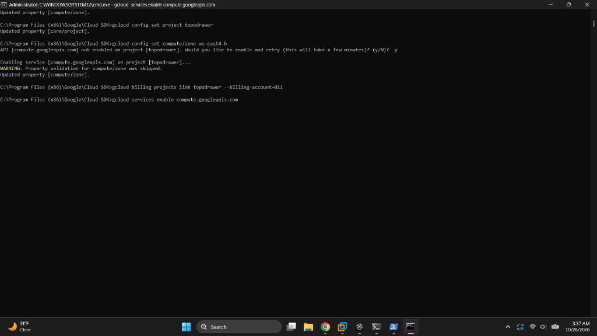
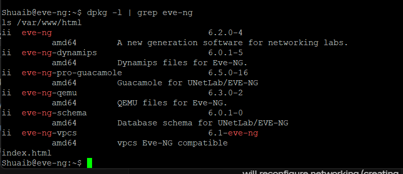
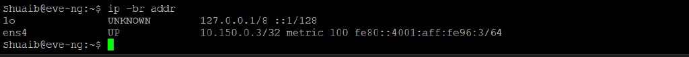
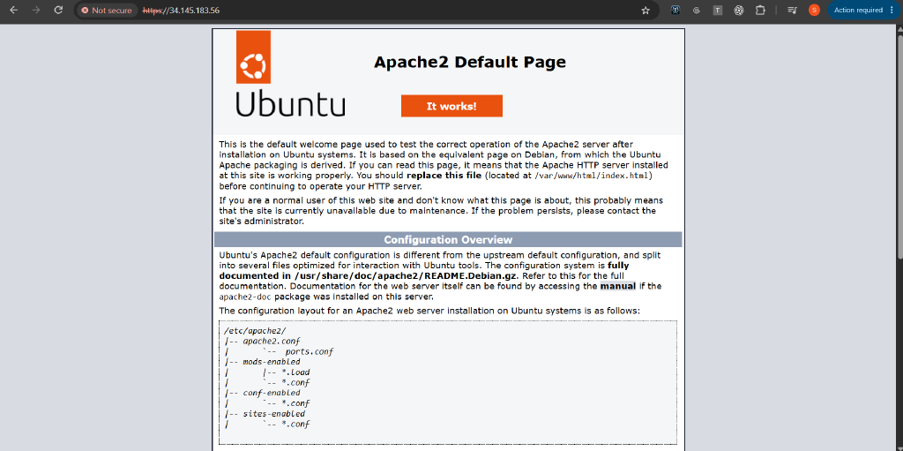
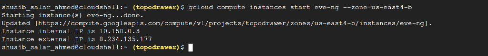
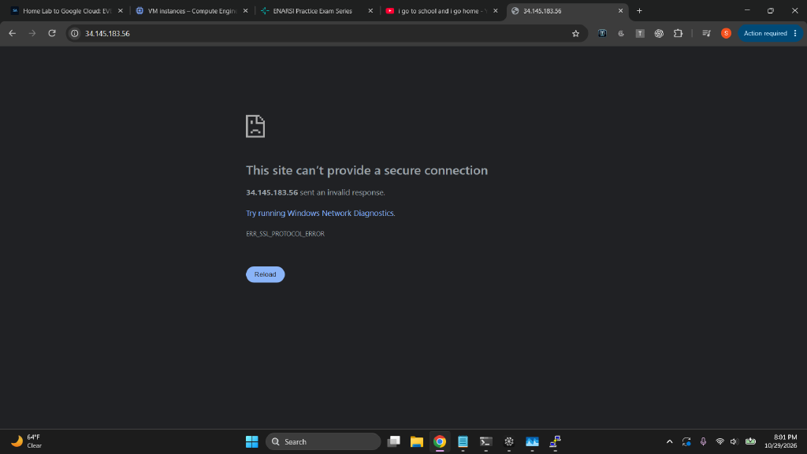
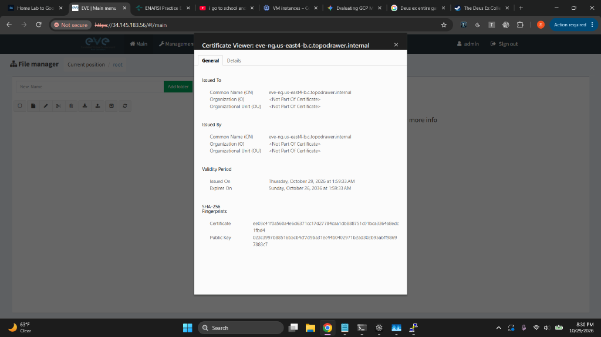
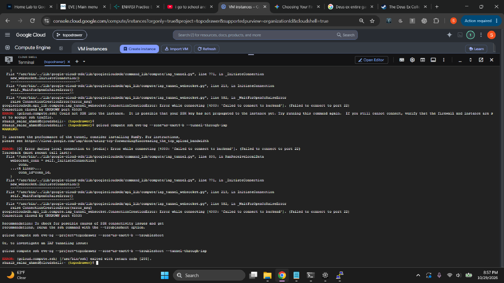
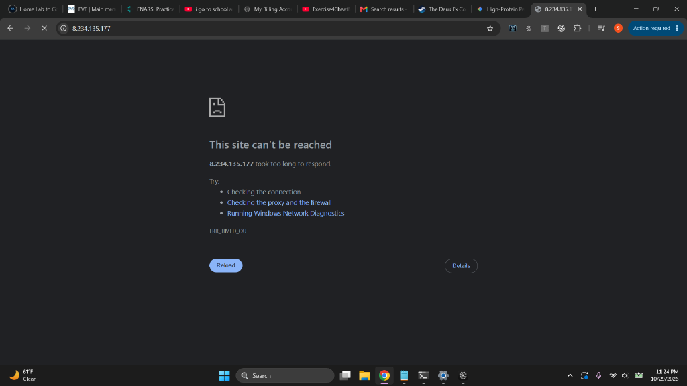
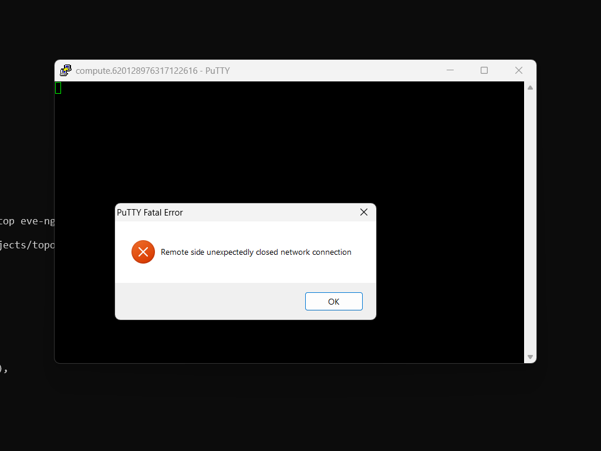

# Migrating EVE-NG from a Home Lab to Google Cloud

**Author:** Shuaib Ahmed
**Dates:** October 27–30, 2026
**Goal:** Host ~70 simulated network devices in the cloud for well under $1/hour, then move a custom red-team/blue-team range platform (TopoDrawer) on top of it.
**Status:** **Paused.** EVE-NG is installed on the cloud VM, but the VM lost its network on the evening of October 29 after a live network change. A disk-rescue recovery is planned and has not been run yet. See §13.

> **Revision note (October 30, 2026).** The first version of this report (commit `38d63f8`, October 29, 2:50 AM EDT) was drafted by an AI assistant a few minutes after the EVE-NG web page first loaded. Several of its claims were never checked, and some were wrong. This version corrects them, adds what happened on day 2, including the outage, and explains how and why the AI assistants (and I) got things wrong. Every correction is listed in **Appendix A**. **Appendix B** is a compressed, one-shot runbook for doing this build correctly.

---

## 1. Executive summary

My home EVE-NG server (a physical box on my LAN) hits a hard RAM ceiling: ~10 running nodes is comfortable, ~15 is not. The plan was to replace it with a rented Google Cloud VM sized for **70 IOSv-class nodes**, on Spot pricing (about **$0.20/hour**), reachable from **my IP address only**.

What went right: billing recovery, the VM itself (8 vCPU / 64 GB with nested virtualization), the firewall design, and an EVE-NG install that worked over HTTP on day 1 and over HTTPS on day 2.

What went wrong: EVE-NG was installed with a hand-built method instead of the official Google Cloud procedure. That skipped the installer's Google Cloud network tuning and its setup wizard, so EVE's network bridge (`pnet0`) was never created. On day 2, an AI assistant gave me a paste-ready command to bring that bridge up live, over my only SSH session. I ran it. The VM dropped off the network and every rescue path we tried depended on the network that had just broken.

| Battle | Symptom | Root cause | Fix / status |
|---|---|---|---|
| Billing setup | `FAILED_PRECONDITION` on project link | Billing account self-closed after signup ("not in good standing") | New payments profile + verified card + one-time $30 prepayment |
| Instance sizing | `free -h` showed **3.6 GiB**, not 64 GB | Instance created from console defaults | `set-machine-type n2-highmem-8` on the stopped VM |
| Nested virtualization | `kvm-ok`: "KVM acceleration can NOT be used" | Nested virt was not enabled on that VM | Deleted and recreated with `--enable-nested-virtualization`. (It can also be enabled on an existing VM; the "creation only" claim was wrong. See §6.3.) |
| Shell syntax | `gcloud` rejected multi-line create | Bash `\` continuations pasted into `cmd.exe` | One-line command (or Git Bash) |
| PowerShell lists | `--rules=tcp:22,tcp:23,...` rejected | PowerShell splits bare comma lists into separate arguments | Quote the value |
| SSH exposure | `default-allow-ssh` open to `0.0.0.0/0` | Google's network defaults | Deleted; replaced with an IP-scoped rule |
| Web UI unreachable (day 1) | Timeouts from home | Firewall source IP mistyped (73.217… vs 72.227…) **and** port 80 missing from the rule | Rule updated; EVE loaded over **HTTP** |
| HTTPS (days 1–2) | HTTPS showed Apache's default page, then `ERR_SSL_PROTOCOL_ERROR` | Ubuntu's stock `default-ssl` site was enabled instead of an EVE SSL site | Added a `<VirtualHost *:443>` for EVE; HTTPS worked on day 2 |
| **Network outage (day 2)** | SSH froze; VM unreachable on every path | Live `ifup pnet0` on a hand-built bridge config, without the official GCP tuning | **Open.** Disk-rescue planned (§13) |

---

## 2. Why move to the cloud

EVE-NG nodes are virtual machines, and RAM is the binding constraint:

| Node type | RAM per node | 70 nodes |
|---|---|---|
| Cisco IOSv (L3) | ~512 MB | ~35 GB |
| Cisco IOSvL2 (switching) | ~768 MB–1 GB | ~55–70 GB |
| CSR1000v | 3–4 GB | impractical at 70 nodes |

Add ~6–8 GB for the EVE-NG host itself. The home server cannot hold 64 GB of guest RAM; a rented cloud VM can.

**Instance selection:**

| Machine type | vCPU / RAM | On-demand $/hr | Verdict |
|---|---|---|---|
| `n2-highmem-8` | 8 / 64 GB | ~$0.55 | 70 × IOSv comfortable, ~50 × IOSvL2 max |
| `n2-highmem-16` | 16 / 128 GB | ~$1.05 | 70 × IOSvL2 without compromise |
| Spot variants | same | ~65% cheaper | GCP can evict with ~30 s warning |

**Chosen:** `n2-highmem-8` on Spot. The N2 family matters because EVE-NG needs **nested virtualization**, which Google does not support on E2 machines (or on ARM, memory-optimized, or most AMD types). EVE's own cookbook recommends N2 on Intel Cascade Lake. The "highmem" skew toward RAM is exactly what 70 router VMs need.

Two flags make Spot survivable for lab work:

- `--provisioning-model=SPOT`: the discount
- `--instance-termination-action=STOP`: on preemption, **stop the VM instead of deleting it**, so disk, labs, and images survive

Rough math: ~150 hours of 70-node labbing from a $30 credit. A stopped VM costs only its disk (~$9/month) plus the reserved IP (§11).

---

## 3. Target architecture

```
┌─────────────────────────── My Windows laptop (NYC) ───────────────────────────┐
│  Browser ──► EVE-NG web UI          TopoDrawer bridge (127.0.0.1:8766)         │
│  gcloud CLI / Cloud Shell ──► SSH   (to be re-pointed at the cloud VM)         │
└────────────┬──────────────────────────────────────┬───────────────────────────┘
             │ HTTP 80 / HTTPS 443 / SSH 22          │ telnet 32768–32999 (node consoles)
             ▼                                      ▼
┌──────── GCP VM "eve-ng" (us-east4-b, Spot, n2-highmem-8, static IP 8.234.135.177) ────────┐
│  Ubuntu 22.04 LTS → EVE-NG Community Edition 6.2                                           │
│  /opt/unetlab: labs (.unl) + node images (addons/)                                         │
│  70-node capacity: 62.8 Gi RAM usable after host overhead                                  │
└────────────────────────────────────────────────────────────────────────────────────────────┘
             ▲
             │  tar stream over SSH (planned migration)
┌────────────┴───────────────────────────────────────────────────────────────────┐
│  Home EVE-NG arena server (192.168.1.107) — custom TopoDrawer layer            │
│  ISP_Failover_IPS.unl: red/blue rosters, SLA scoring, convergence streak       │
└────────────────────────────────────────────────────────────────────────────────┘
```

The home server stays online as the working environment until the cloud VM passes every gate. Nothing on it is modified by the migration. The cloud VM *pulls* copies.

---

## 4. The billing campaign

### 4.1 The setup trap

GCP refuses to run *anything* on a project without a billing account attached, even free-tier resources. The first signup attempt produced a billing account that then **closed itself**:


The banner: *"This billing account is closed. Reopen it to continue using linked projects."* Linking it to the project returned `FAILED_PRECONDITION`, which read like a permissions problem but was actually a dead account. Reopening it was denied:

> *"You can't reopen this billing account because this account is not in good standing."*

"Not in good standing" points below the billing account, at the **Google Payments profile** underneath it. That is almost always a failed card verification charge or a declined card during signup.

### 4.2 The recovery

1. Created a **new payments profile** at `pay.google.com` with a verified bank-issued Mastercard. Prepaid and virtual cards often fail Google's verification and close the account again, which is probably what happened the first time.
2. GCP then required a **one-time $30.00 prepayment** to activate the new profile:


3. The $30 cleared and posted as spendable credit:


### 4.3 The outcome: the lost trial

After the prepayment cleared, the account read **"Paid account,"** not "Free trial account." Billing → Credits showed why:


*"No credits to display."* The first signup attempt, the one whose account closed itself, had used up the one-free-trial-per-person allowance. Google counts the attempt, not the outcome.

**Decision:** proceed without the trial. The $30 prepayment became spendable credit, which at Spot pricing buys ~150 hours of 70-node labbing. (Fallback for later: Azure for Students, $100/year with no card. Ubuntu + KVM + EVE-NG is cloud-agnostic.)

**Billing lessons:**

- A `FAILED_PRECONDITION` on `billing projects link` can mean "account is closed," not "check your IAM roles." Read the account state before reading the error.
- Card verification is the fragile link. Use a real bank card.
- Billing accounts have states (open / closed / not in good standing). Check the banner, not just the API error.

---

## 5. Shell lessons (the tax paid for cross-shell work)

The work crossed four shells: `cmd.exe`, PowerShell, Git Bash, and Google Cloud Shell (bash in the browser). Each broke commands differently.

### 5.1 Bash line continuations pasted into cmd.exe

A multi-line `gcloud compute instances create` with trailing backslashes (`\`), normal bash style, ran as line-by-line garbage in `cmd.exe`, which has no line continuations:


The first line ran with a trailing `\` baked into the instance name (a regex error on `resource.name`), and every following `--flag` line ran as its own command. Fix: one line in cmd, or use Git Bash.

### 5.2 PowerShell splits bare comma lists

```powershell
gcloud compute firewall-rules update eve-ng-lab --rules=tcp:22,tcp:23,tcp:80,tcp:443
```

PowerShell parses `a,b,c` as an **array** and hands gcloud separate arguments. gcloud re-joined them with spaces and rejected the result:

```
Firewall rules must be of the form PROTOCOL[:PORT[-PORT]]; received [tcp:22 tcp:23 tcp:80 tcp:443]
```

The spaces where commas should be are the tell that the shell rewrote the argument. Fix: quote it. Quoting works in bash too, so always quote:

```powershell
gcloud compute firewall-rules update eve-ng-lab --rules="tcp:22,tcp:23,tcp:80,tcp:443"
```

### 5.3 Copy-paste truncation of long IDs

Billing account IDs are 18 characters in three 6-character groups (`011C63-DA984C-4695BB` style). Several failures came from pasting a 17-character prefix:



The fix is to stop retyping IDs and let the CLI print them:

```bash
gcloud billing accounts list
```

### 5.4 Multi-line scripts in Cloud Shell

During the outage (§12), several rescue scripts were sent as heredocs and multi-line pastes for Cloud Shell. Some arrived broken ("step 1 formatted incorrectly"), and one had to be rewritten to load from a file with `--metadata-from-file`. Under pressure, the safest format is one short command per step, with its expected output.

### 5.5 Finding the SDK at all

The Google Cloud SDK for Windows installs to:

```
C:\Program Files (x86)\Google\Cloud SDK\google-cloud-sdk\bin
```

`gcloud` is not a separate app. It is a command that any terminal runs once that `bin` folder is on the `PATH`. PATH changes need a **new terminal**; open shells never re-read it.

---

## 6. Building the VM

### 6.1 The create command, flag by flag

```bash
gcloud compute instances create eve-ng \
  --machine-type=n2-highmem-8 \
  --image-family=ubuntu-2204-lts --image-project=ubuntu-os-cloud \
  --boot-disk-size=100GB --boot-disk-type=pd-balanced \
  --provisioning-model=SPOT \
  --instance-termination-action=STOP \
  --enable-nested-virtualization \
  --tags=eve-ng
```

| Flag | Why it matters |
|---|---|
| `--machine-type=n2-highmem-8` | 8 vCPU / 64 GB, RAM-skewed family that supports nested virt |
| `--image-family=ubuntu-2204-lts` | EVE-NG CE targets Ubuntu 22.04 (Jammy) |
| `--provisioning-model=SPOT` | ~65% discount, eviction possible |
| `--instance-termination-action=STOP` | preemption stops the VM instead of deleting it |
| `--enable-nested-virtualization` | exposes hardware virtualization to the guest so `/dev/kvm` exists and EVE-NG can run nodes |
| `--tags=eve-ng` | lets firewall rules target the lab VM by role |

What this command was missing, compared with EVE's official Google Cloud guide (Appendix B has the corrected version): Secure Boot and vTPM disabled, the static IP attached at creation, and the serial console enabled from the start.

### 6.2 Failure #1: the wrong machine

The first instance came up from console defaults (small machine, Debian, no nested virt):


`free -h` showing 3.6 GiB on a machine specced at 64 GB is an instant mismatch flag. Diagnosis:

```bash
gcloud compute instances describe eve-ng --format="value(machineType)"
```

The machine type was fixed the cheap way, on the stopped instance:

```bash
gcloud compute instances stop eve-ng --zone=us-east4-b
gcloud compute instances set-machine-type eve-ng --machine-type=n2-highmem-8 --zone=us-east4-b
gcloud compute instances start eve-ng --zone=us-east4-b
```

`set-machine-type` only works on a **stopped** instance. The disk is untouched; only the hardware underneath changes.

### 6.3 Failure #2: no nested virtualization (and a false claim)

After resizing, the virtualization check failed:


```
INFO: Your CPU does not support KVM extensions.
KVM acceleration can NOT be used.
```

`kvm-ok` (from `cpu-checker`) reads the CPU flags from inside the guest. Run it **before** installing EVE-NG. EVE-NG installs fine on a host without virtualization and then fails at every node boot.

**Correction.** The first version of this report said nested virtualization "can only be enabled at instance creation" and is "attached to the boot disk as a license." That came from the AI assistant at the time (around 10:56 PM EDT on October 28) and was not checked. It is wrong. The license method is the older way. Google's current docs show enabling it on an **existing** VM:

```bash
gcloud compute instances export eve-ng --zone=us-east4-b --destination=eve-ng.yaml
# edit eve-ng.yaml:
#   advancedMachineFeatures:
#     enableNestedVirtualization: true
gcloud compute instances update-from-file eve-ng --zone=us-east4-b --source=eve-ng.yaml --most-disruptive-allowed-action=RESTART
```

The delete-and-recreate still turned out fine, because the instance was 40 minutes old, ran the wrong OS (Debian), and had nothing on it. But the reason given for it was false. When I asked a different model (GPT) about the same problem later that night, it said to check the VM's setting and not to delete or recreate. That was the better instinct.

### 6.4 The proof

After the recreate, the foundation checks passed:


- `free -h` → **62Gi** (64 GB minus kernel reserve)
- `lscpu` → **CPU(s): 8**
- `/dev/kvm` present: `crw-rw---- 1 root kvm 10, 232`

---

## 7. Nested virtualization, precisely

```
Google's physical server (Xeon, hardware VT-x)
  └── Google's hypervisor (your VM is a guest here)
        └── your Ubuntu VM ("eve-ng")
              └── KVM (/dev/kvm) → EVE-NG nodes: IOSv, IOSvL2, QEMU images
```

Normally a hypervisor hides the CPU's virtualization extensions from its guests. Nested virtualization makes Google pass VT-x *through* to the guest. Inside the VM, `/dev/kvm` either exists (it works) or it doesn't (nothing EVE-NG does afterward will matter).

Google's limits: no nested virt on E2, ARM, memory-optimized, or most AMD machine types; the guest hypervisor must be Linux KVM. It can be set at creation with `--enable-nested-virtualization` or turned on later on a stopped VM (§6.3).

---

## 8. Firewall architecture

Rule set as of October 29 (from `gcloud compute firewall-rules list` on day 2, plus the IAP rule created during the outage):

| Rule | Allows | Sources | Purpose |
|---|---|---|---|
| `eve-ng-lab` | tcp:22, 23, 80, 443 | `72.227.164.24/32` | My access: SSH, telnet, HTTP, HTTPS |
| `eve-ng-consoles` | tcp:32768–32999 | `72.227.164.24/32`, target tag `eve-ng` | Node consoles for the TopoDrawer arena bridge |
| `allow-iap-ssh` | tcp:22 | `35.235.240.0/20` | Google IAP rescue path. **Created during the outage on day 2**, not on day 1 (§12) |
| `default-allow-internal` | all tcp/udp/icmp | `10.128.0.0/9` | VPC-internal traffic (untouched) |
| `default-allow-icmp` | icmp | `0.0.0.0/0` | Google default (untouched) |
| `default-allow-rdp` | tcp:3389 | `0.0.0.0/0` | Google default. **Still present.** The first version said it was deleted; it wasn't. Nothing listens on 3389, but it should be deleted |
| ~~`default-allow-ssh`~~ | ~~tcp:22~~ | ~~`0.0.0.0/0`~~ | **Deleted** on day 1 |

Principles that held up:

1. **ALLOW rules stack; they don't subtract.** Each rule only *adds* permitted traffic. The implicit deny applies only when no rule allows. A rule for ports 32768–32999 cannot "block" 443.
2. **The internet-wide default was the real exposure.** `default-allow-ssh` (port 22 from anywhere) made the scoped rule pointless until it was deleted. GPT flagged it on day 1 and was right.
3. **A rescue path only counts once it exists and has been tested.** The IAP rule was "in the plan" for a whole day but was never created. When it was finally needed, it was created in a hurry and still couldn't help, because IAP needs the guest's own network to be up (§12).

**Correction: the "rotating home IP" story.** The first version said my ISP rotated my IP overnight and that this locked me out. The evidence says otherwise. The original rule used `73.217.164.24`; my real IP was `72.227.164.24`. Those differ in two digits, not "one digit" as the assistant said, and only about four hours passed, not a night. My IP was still `72.227.164.24` the next day. The most likely explanation is a typo in the IP I supplied, which nobody checked against a "what is my IP" lookup before using it. The fix (updating the rule) was right; the explanation and the lesson built on it were not.

---

## 9. Installing EVE-NG Community on Ubuntu 22.04

### 9.1 What the official method is

EVE-NG's Community Cookbook (v6.3, §3.4 "Google Cloud Platform") gives a specific procedure. In short:

1. Create an N2 VM with nested virtualization, Ubuntu 22.04, **Secure Boot and vTPM off**.
2. As root, run the official installer: `wget -O - https://www.eve-ng.net/jammy/install-eve.sh | bash -i`
3. `apt update; apt upgrade`, then reboot.
4. Log back in. When EVE's setup wizard appears, press **Ctrl+C**, run `sudo -i`, and complete the wizard: root password, hostname, domain, **IP: dhcp**, NTP blank, direct connection. The VM reboots itself.
5. Browse to `http://<public IP>` and log in as `admin` / `eve` (then change that password).

The installer does more than add a package repository. When it detects Google Cloud, it runs a GCP tuning step that:

- renames the NIC from `ens4` to `eth0` and updates the netplan file to match
- holds Google's kernel package and boots EVE's kernel instead
- **removes cloud-init** and disables the "wait for network" service
- enables SSH password login, permits root login, and sets the root password to `eve` (which the wizard then changes)

The wizard then builds `pnet0`, the bridge EVE uses for its management network, on top of `eth0`.

### 9.2 What was actually done

The AI assistant didn't find the cookbook. EVE's website pointed its Google Cloud page at the PRO edition, and the repository hostnames it tried from memory (`install.eve-ng.net`, `apt.repos.eve-ng.net`) didn't resolve. It then read EVE's *update* script (`update-eve-ce.sh`), pulled the repository URL and signing key from it, and installed the `eve-ng` package by hand:

```bash
sudo -i
apt-get update && apt-get -y upgrade
apt-get -y install gnupg
wget -O - http://www.eve-ng.net/jammy/eczema@ecze.com.gpg.key | gpg --dearmor -o /etc/apt/trusted.gpg.d/eve-ng.gpg
echo "deb [arch=amd64] http://www.eve-ng.net/jammy jammy main" > /etc/apt/sources.list.d/eve-ng.list
apt-get update
apt-cache policy eve-ng
DEBIAN_FRONTEND=noninteractive apt-get -y install eve-ng
```

Reading a script before running it was a good habit, and the package did install correctly. On day 2, `dpkg` showed every EVE package in state `ii` (installed):



Two commands in that block are worth knowing:

- **`wget -O -`** downloads a file and writes it to standard output (the `-`), so it flows straight into the next command.
- **`gpg --dearmor`** converts an ASCII key (`-----BEGIN PGP PUBLIC KEY BLOCK-----`) into the binary format APT reads from `/etc/apt/trusted.gpg.d/`. APT refuses packages it can't verify against a trusted key.

But this path skipped **all** of the GCP tuning and the setup wizard. Nothing renamed the NIC, nothing removed cloud-init, nothing built `pnet0`. On day 2, `ip -br addr` showed the NIC still named `ens4`, holding the VM's internal address directly, and no bridge at all:



The web UI still worked, because Apache doesn't care whether the address sits on a bridge. Lab nodes that need EVE's management cloud (`pnet0`) would not have worked. This gap is what the day-2 outage grew out of.

### 9.3 Correction: "the one step that can brick the VM"

The first version described editing `/etc/network/interfaces` to bind `pnet0` to `ens4`, disabling cloud-init's network config, and enabling the serial port, and then said: "Verification after reboot: `ip -br addr` shows `pnet0` holding the VM's internal IP." **None of that had happened when the report was published.** It was a plan written as if it were a result. The screenshot above, taken on day 2, shows the real state.

---

## 10. Day 1 web debugging (October 29, ~2 AM EDT)

After the install, the web UI timed out from home. Two real problems were found, and one fix was wrong.

**Found correctly: port 80 was never allowed.** The rule allowed 22, 23, and 443. Traffic to 80 hit the implicit deny no matter how healthy Apache was:

```powershell
gcloud compute firewall-rules update eve-ng-lab --rules="tcp:22,tcp:23,tcp:80,tcp:443"
```

**Found correctly, explained wrongly: the source IP.** The rule's source was the mistyped `73.217.164.24`. It was updated to `72.227.164.24` (see §8 for why "rotated overnight" was wrong).

**Wrong fix: HTTPS.** `ss -tlnp` showed Apache on port 80 only. The assistant said to run `a2enmod ssl && a2ensite default-ssl`, describing `default-ssl` as a site "EVE-NG's package pre-configured." It isn't. `default-ssl` is Ubuntu's stock Apache site, and it serves `/var/www/html`, the "It works!" page, not EVE. So HTTPS answered, but with the wrong website:



After those changes, **EVE loaded over plain HTTP**:


That was the real day-1 finish line. The first version of this report called it "live on HTTPS," which it wasn't.

**Testing a web port vs. "ping":** `ping` uses ICMP and has no ports. Use:

```powershell
Test-NetConnection 8.234.135.177 -Port 443    # raw TCP reachability
curl.exe -kI https://8.234.135.177            # the web service actually answering
```

---

## 11. IPs: ephemeral vs. reserved

The VM's external address can have two lifetimes:

- **Ephemeral:** assigned at start, released on stop. This VM's IP changed three times: `34.181.128.173` (day 1) → `34.181.183.55` (day 2 start) → `34.145.183.56` (after a stop and start mid-debugging). Bookmarks, firewall notes, and the TopoDrawer bridge config rot every time.
- **Reserved (static):** allocated once, survives stop/start.

What actually happened:

1. Day 1: `gcloud compute addresses create eve-ng-ip --region=us-east4` **succeeded** (proved later by an "already exists" error).
2. Day 1: attaching it failed twice. First with `--address=eve-ng-ip` (`add-access-config` wants the numeric IP, not the resource name), then with "At most one access config currently supported" (the VM already had an ephemeral IP, which has to be removed first). GPT fixed the PowerShell version of the script but missed the existing access config, and said so.
3. Day 2, during the outage: the address was finally attached with delete-then-add while the VM was stopped:

```bash
gcloud compute instances delete-access-config eve-ng --zone=us-east4-b --access-config-name="external-NAT"
gcloud compute instances add-access-config eve-ng --zone=us-east4-b --address=8.234.135.177
```



Note: `instances create --address` *does* accept the reserved address's name. Only `add-access-config` needs the number. Attaching at creation time avoids this whole problem.

**Cost correction.** The first version said a reserved IP costs "less while detached." It's the opposite. Google charges **more** for a reserved IP that isn't attached to anything, and an IP attached to a *stopped* VM still counts as in use. So the address sat unattached for a day at the higher rate. The amounts are cents, but the rule matters: reserve and attach together.

---

## 12. Day 2: the HTTPS chase and the outage (October 29, evening EDT)

### 12.1 Timeouts and four wrong theories (7:13–8:00 PM)

After starting the VM, the web UI timed out again. The assistant tried, in order:

| Theory | Test | Result |
|---|---|---|
| Home IP rotated again | checked my IP | Same `72.227.164.24`. Disproven |
| `ufw` blocking | `ufw status`, `iptables -L` | ufw inactive, iptables ACCEPT. Disproven |
| Firewall tag mismatch | rule/tag review | Disproven |
| "EVE never finished installing; the app is in `/var/www/html`" | `dpkg -l`, file check | All packages `ii`; EVE lives in `/opt/unetlab/html`. Disproven; the assistant admitted it |

The original timeouts were never explained. The most likely cause is the ephemeral IP changing on restart while I was still browsing to the old one, but that was never confirmed. Meanwhile, HTTPS still showed the Apache default page (§10).

### 12.2 The ERR_SSL_PROTOCOL_ERROR (8:01 PM)

A search found EVE's Apache site, `unetlab.conf`, in `sites-available` but not enabled. The assistant had me run `a2dissite 000-default default-ssl` and `a2ensite unetlab`, saying unetlab's "own SSL vhost handles 443." It doesn't have one. With SSL loaded, Apache still listened on 443, but no site there spoke TLS, so it answered in plain HTTP and the browser rejected it:



### 12.3 HTTPS working (8:30 PM)

The fix that worked was adding a `<VirtualHost *:443>` block to `unetlab.conf` with `SSLEngine on`, Ubuntu's self-signed "snakeoil" certificate, and the same proxy rules EVE's port-80 site uses for its HTML5 console. EVE loaded over HTTPS, with a self-signed certificate issued to the VM's internal hostname:



This is the only point in the project where EVE was actually "live on HTTPS."

### 12.4 The outage (8:43 PM)

Next, the assistant wrote a migration plan. Its "Phase 0" was to fix the missing `pnet0` bridge. In one message it asked to see the interface files first, **and** gave paste-ready commands to change them and apply the change live:

1. `sed` to change `bridge_ports eth0` to `bridge_ports ens4` in `/etc/network/interfaces`
2. disable cloud-init's network config
3. **`sudo ifup pnet0`**, with the warning to "expect SSH hesitation… a handover, not a failure"
4. if it went wrong, rescue through IAP

I ran them. The terminal froze. Here's why. `ifup pnet0` turns `ens4` into a bridge port. A bridge port can't keep its own IP address, so `ens4` lost `10.150.0.3` and my SSH session (which was using that address) died. The bridge then had to get a new address from Google's DHCP server. Whatever happened next, the VM never came back on the network, and it didn't recover after a reboot either.

The exact boot-time failure isn't confirmed yet, because nobody can log in to look. The leading theory: two network systems now fight over the same NIC. Ubuntu's cloud image configures `ens4` with netplan; the edited `/etc/network/interfaces` tells EVE's ifupdown to enslave `ens4` into `pnet0`. The official installer avoids this by renaming the NIC, rewriting netplan, and removing cloud-init. None of that ran here (§9.2).

The rescue path in step 4 didn't exist. `allow-iap-ssh` had been promised on day 1 but never created.

### 12.5 Rescue attempts that depended on the broken network (8:45–11:30 PM)

| Attempt | Why it couldn't work |
|---|---|
| Create `allow-iap-ssh`, then `gcloud compute ssh --tunnel-through-iap` | IAP forwards to port 22 on the VM's internal IP. With the guest network down, there's nothing to connect to: "failed to connect to backend" (below) |
| Startup scripts v1–v3 via instance metadata (lo-only interfaces; then add a temporary password and enable the serial port; then plain DHCP on `ens4`) | The assistant said metadata "works even when network config is wrecked." It doesn't. The guest agent downloads startup scripts from the metadata server *over the guest's network*. No network, no script. None of the three showed any sign of running |
| Serial console login | The serial port reaches the VM without the network, but logging in needs a local password. The temporary password was to be set by the startup script, which never ran |
| Ephemeral IP → static IP | Correct and useful for later (§11), but unrelated to the outage |







Then the assistant recommended deleting the VM and rebuilding. I came close to doing it. That would have thrown away a working EVE install whose data was fine; only its network config was broken. At that point (about 12:10 AM EDT on October 30) I switched to a different model.

---

## 13. Current state and recovery plan

**State as of October 30, 2026:**

| Item | State |
|---|---|
| VM `eve-ng` | Exists, n2-highmem-8 Spot, nested virt on. **No working network.** Stopped when not being worked on |
| Disk | Intact as far as known. EVE-NG 6.2 packages installed; `unetlab.conf` has the working 443 vhost |
| Static IP | `8.234.135.177` reserved and attached |
| Firewall | As in §8; `allow-iap-ssh` exists; `default-allow-rdp` still to delete |
| Metadata | Contains a leftover `startup-script` (to remove) and `serial-port-enable` |
| TopoDrawer migration | Not started. Home server unchanged and working |

**Recovery plan (disk rescue, not yet run).** The idea: the broken VM can't fix itself, so attach its disk to a healthy temporary VM, fix the files there, and move the disk back. Full commands are in Appendix B, step R12. In outline:

1. Optional: save the serial-port log (`get-serial-port-output`) as evidence of what boot actually did.
2. Stop the VM and **snapshot the disk** (`eve-ng-before-rescue`) so nothing in the rescue can make things worse.
3. Detach the disk; create a small Debian rescue VM with the disk attached as a non-boot, keep-on-delete disk.
4. SSH to the rescue VM through IAP (its network works). Mount the EVE disk.
5. Read `/etc/network/interfaces` and `/etc/netplan/` before changing anything. Back up the interfaces file, then reduce it to loopback only so netplan alone brings up `ens4` with DHCP. **If netplan has no config for the NIC, stop**, because nothing would bring the network up.
6. Set a local password for my user inside the disk (`chroot … passwd`) so the serial console works next time.
7. Unmount, delete the rescue VM, reattach the disk as boot, remove the leftover startup script, start the VM, and verify `ens4` has `10.150.0.3` and `https://8.234.135.177` loads.

After that, `pnet0` still needs to be done properly: with the serial console tested first, using the official installer's GCP steps and wizard, not a live `ifup`. The TopoDrawer arena's `CUST-EDGE` node (which takes DHCP through `pnet0`) will need a redesign for the cloud anyway.

---

## 14. How the AI assistants failed: what, why, and how

I built this with AI assistants in a Factory Droid session. Several models took turns. I'm including this section because the failures are as instructive as the networking, and because the first version of this report hid them.

### 14.1 Who was involved

| Window (UTC) | Model | Main contributions |
|---|---|---|
| Oct 28 03:42 → Oct 29 04:46 | GLM 5.3 Flash | Billing help, VM build, nested-virt claim, firewall rules, hand-built install |
| Oct 29 04:49 → 05:24 | GPT 6.1 | Static-IP script, flagged `default-allow-ssh` |
| Oct 29 05:28 | Gemini 3.8 Flash | One answer (config file location), correct |
| Oct 29 05:45 → Oct 30 04:05 | GLM 5.3 Flash | Day-1 web fixes, first report, day-2 HTTPS chase, outage, rescue attempts |
| Oct 30 04:10 → | Claude Opus | Failure analysis, recovery plan, this revision |

### 14.2 What went wrong, and why

**1. Claims from memory stated as facts.** The pattern behind most errors: a plausible-sounding rule was stated confidently and never checked against documentation or the VM.

| Claim | Reality |
|---|---|
| Nested virt "can only be enabled at instance creation" | Can be enabled on an existing VM (§6.3) |
| `default-ssl` is "pre-configured" by EVE | Ubuntu stock site serving the default page (§10) |
| `unetlab` has its "own SSL vhost" for 443 | It has no 443 vhost (§12.2) |
| The home IP "rotated overnight," "one digit" changed | Typo; two digits; four hours; IP unchanged next day (§8) |
| Metadata startup scripts work "even when network config is wrecked" | They are fetched over the guest network (§12.5) |
| "EVE never finished installing" | All packages installed (§12.1) |

*Why:* language models produce fluent, specific answers whether or not they know. Without a habit of "show me the doc or the output," a guess and a fact look identical.

**2. The official source was never found.** EVE publishes a Google Cloud procedure (Cookbook §3.4) and an installer with a GCP-specific step. The assistant rebuilt the install from a different script, which skipped exactly the parts that make networking safe on Google Cloud. *Why:* when the first two guesses failed DNS, it reverse-engineered a working path instead of looking for the documented one. The install "worked," so the missing pieces stayed invisible until day 2.

**3. The write-up got ahead of the evidence.** The first report was drafted minutes after the UI loaded. It said HTTPS was live, `pnet0` was verified, the IAP rule existed, `default-allow-rdp` was deleted, and the static IP was attached. None of those were true. *Why:* the report was written from the plan, not from what had actually been checked. The "Verification gates" table even listed the bridge gate as passed when it had never been run.

**4. Guessing instead of isolating on day 2.** Four theories in a row (IP rotation, ufw, tags, incomplete install), and fixes were applied before the cause was known (enabling and disabling Apache sites). *Why:* each theory was tested only far enough to move to the next one. Nobody first wrote down what had changed since the night before (the ephemeral IP had).

**5. A risky change made over the only way in.** `ifup pnet0` changes the network the SSH session is running on. The command was given as paste-ready, at night, with an untested rescue path, and the expected SSH drop was described as "a handover, not a failure." The same message also asked to see the files first, so the "look first" step and the "change it now" step arrived together. *Why:* no rule like "never change the network you are standing on" and no check that the rescue path worked before using it.

**6. Recovery that needed the broken thing.** IAP and startup scripts both need the guest's network. Three versions of the startup script were tried before the approach itself was questioned. Then the recommendation jumped to deleting and rebuilding, which would have destroyed a working install. *Why:* the assistant didn't separate "paths that need the guest network" from "paths that don't" (serial console with a password, or working on the disk from another VM).

**7. Communication.** Replies were long, and the one command that mattered was often buried. Several multi-line commands broke in Cloud Shell. I told the assistant it was being wordy and giving wrong commands, and that didn't change much.

### 14.3 What the assistants got right

To be fair, plenty was right: GLM caught the wrong machine type with `free -h`, insisted on `kvm-ok` before installing, found the missing port 80, read the update script before running it, wrote the 443 vhost that finally worked, created the IAP rule and attached the static IP correctly, and admitted its errors when shown evidence. GPT flagged the open SSH default and advised against deleting the VM. Gemini's single answer was correct.

The model that helped write this revision (Claude Opus) also overstated one thing: it first told me the outage happened because "Google's network won't give the bridge an address." That's wrong; EVE's official GCP setup runs `pnet0` on DHCP without trouble. It corrected that before this report was written. Its recovery plan (§13) has not been run, so it isn't proven either.

### 14.4 My part

It was my rush to get the migration done that kept me from seeing what was wrong. I pasted commands as fast as they came, including a live network change on the only connection into the VM, without asking "what happens if this fails?" or "have we tested the rescue path?" The home IP I supplied for the firewall had two digits wrong. And I published a report without checking it against my own screenshots, which would have caught most of the false claims in minutes.

### 14.5 What I'm changing

1. **Official docs first.** For any install, find the vendor's guide for that exact platform and read the installer end to end.
2. **Never change the network on the only path in.** Before any network change: snapshot the disk, set a local password, and **test** the serial console.
3. **One step, one expected output.** Run one command, compare the output with what was expected, and stop at the first mismatch.
4. **A claim needs evidence.** In reports and in chat, every "it works" points to a command output or a screenshot. Plans are labeled as plans.
5. **Ask the AI for sources.** When an assistant states a rule ("only at creation," "pre-configured"), ask where it comes from.

---

## 15. Access model

A stock GCP Ubuntu VM has **no root password**: root is locked, password SSH is off, and access is by SSH key (`gcloud compute ssh` creates one) plus passwordless `sudo`:

```bash
sudo <command>    # one privileged command
sudo -i           # full root shell
```

**Correction.** The first version said this was the access model of the EVE VM. EVE's official installer changes it on Google Cloud: it enables password SSH, allows root login, and sets the root password to `eve` until the wizard replaces it. With port 22 open only to my IP and IAP, that's tolerable, but the wizard's password step is not optional. Change `admin/eve` on the web UI too.

There's a second lesson from the outage: **a VM with no local password has no working serial console.** Set one before any risky change.

---

## 16. Verification gates

| Gate | Check | Pass condition | Status |
|---|---|---|---|
| Billing | `gcloud billing projects describe topodrawer` | `billingEnabled: true` | Passed |
| VM specs | `free -h`, `nproc` | ~62 Gi, 8 CPUs | Passed |
| Nested virt | `ls /dev/kvm`, `kvm-ok` | device exists; "can be used" | Passed |
| EVE packages | `dpkg -l eve-ng` | `ii` | Passed (day 2) |
| Bridge | `ip -br addr` | `pnet0` holds the internal IP | **Never passed.** No `pnet0` |
| Web (HTTP) | browser `http://<IP>` | login works | Passed (day 1) |
| Web (HTTPS) | browser `https://<IP>` | EVE login, not Apache default | Passed (day 2, 8:30 PM) |
| Rescue path | serial console login **or** IAP SSH | shell prompt | **Never tested before it was needed** |
| Network after reboot | SSH after `reboot` | reachable | **Failing** (outage) |

---

## 17. Lessons learned

1. **Read errors as state, not as blame.** `FAILED_PRECONDITION` meant "account closed," a failed billing link meant "truncated ID," and "at most one access config" meant "already has an IP."
2. **Verify the foundation before building on it.** `free -h` and `kvm-ok` before anything.
3. **Use the vendor's procedure for the exact platform.** A hand-built install that "works" can still be missing the parts that keep it safe.
4. **Never change the network you're connected through.** Snapshot, set a password, test the serial console, then change it.
5. **A rescue path that hasn't been tested doesn't exist.** Ours was planned on day 1, created mid-outage on day 2, and couldn't help anyway.
6. **Know which rescue paths need the guest network.** SSH, IAP, and startup scripts do. Serial console (with a password) and disk rescue don't.
7. **Know which shell you're in.** The same text is a continuation in bash, garbage in cmd, and an array in PowerShell.
8. **Firewalls are unions of allows.** Deleting the wide default is what makes the scoped rule real.
9. **Report what you verified, not what you planned.** The first version of this report is the example.
10. **Slow down when it matters.** My rush cost more time than every careful step would have.

---

## Appendix A: Corrections to the first version

| # | First version said | What was true | Evidence |
|---|---|---|---|
| 1 | Nested virt "can only be enabled at instance creation… attached to the boot disk as a license" | Can be enabled on an existing VM through `advancedMachineFeatures` | Google Cloud nested-virtualization docs; §6.3 |
| 2 | 443 fixed with `a2enmod ssl && a2ensite default-ssl` | `default-ssl` serves Ubuntu's default page, not EVE | Fig. 16 |
| 3 | "Live on HTTPS at 34.181.128.173" | Day 1 worked over HTTP only; HTTPS worked on day 2 with a new vhost; the IP was ephemeral | Figs. 01, 16–18 |
| 4 | `pnet0` bridged to `ens4`, verified after reboot | Never done; no `pnet0` existed | Fig. 15 |
| 5 | `allow-iap-ssh` in the final rule set | Didn't exist until created during the outage | Day-2 rule list |
| 6 | `default-allow-rdp` deleted | Still present | Day-2 rule list |
| 7 | Static IP attached; "less while detached" | Reserved day 1, attached day 2; unattached costs more | Fig. 11; Google pricing |
| 8 | ISP rotated the home IP overnight | Mistyped IP (73.217 vs 72.227); unchanged next day | Firewall commands; §8 |
| 9 | Install via repo from `update-eve-ce.sh` presented as the method | Official GCP method is `install-eve.sh` + wizard (Cookbook §3.4) | §9.1 |
| 10 | No root password on the EVE VM, by design | EVE's installer sets root/eve and enables password SSH | `install-eve.sh` |
| 11 | All verification gates passed | Bridge gate never run; HTTPS failed on day 1 | §16 |
| 12 | "Cloud-init will fight your network config" (as a learned lesson) | Unverified on this VM; the official installer removes cloud-init | §9.1 |

---

## Appendix B: One-shot runbook (compressed for an AI agent)

Written so an AI agent (or me, later) can run the whole build in one pass without repeating these mistakes. Shell: Google Cloud Shell (bash) unless marked `[VM]` (inside the EVE VM) or `[LAPTOP]`.

```text
RULES (non-negotiable)
G1  One command per step. State EXPECT before running. On mismatch: STOP, report output, do not improvise.
G2  Never run ifup/ifdown/netplan apply/systemctl restart networking over the session you are using.
G3  Never delete a VM or disk. Snapshot before any risky change.
G4  Never claim a state you did not observe. Every "done" cites command output.
G5  Vendor doc first: EVE CE Cookbook §3.4 (GCP). Read install scripts before piping them to bash.
G6  Quote every comma list (--rules="a,b"). Works in bash and PowerShell.
G7  Public IP for firewall comes from the LAPTOP, never from Cloud Shell (Cloud Shell has its own IP).

VARS
P=topodrawer  Z=us-east4-b  R=us-east4  VM=eve-ng
MYIP=<from [LAPTOP]: curl.exe -s https://ifconfig.me>/32      # 72.227.164.24/32 on Oct 29

R0  PREFLIGHT
    gcloud config set project $P
    gcloud billing projects describe $P --format="value(billingEnabled)"      EXPECT True
    gcloud services enable compute.googleapis.com

R1  STATIC IP (reserve + attach at create; unattached reserved IPs cost more)
    gcloud compute addresses create eve-ng-ip --region=$R

R2  FIREWALL
    gcloud compute firewall-rules create eve-ng-lab --direction=INGRESS --action=ALLOW --rules="tcp:22,tcp:23,tcp:80,tcp:443" --source-ranges=$MYIP --target-tags=eve-ng
    gcloud compute firewall-rules create eve-ng-consoles --direction=INGRESS --action=ALLOW --rules="tcp:32768-32999" --source-ranges=$MYIP --target-tags=eve-ng
    gcloud compute firewall-rules create allow-iap-ssh --direction=INGRESS --action=ALLOW --rules="tcp:22" --source-ranges=35.235.240.0/20 --target-tags=eve-ng
    gcloud compute firewall-rules delete default-allow-ssh default-allow-rdp --quiet
    gcloud compute firewall-rules list                                         EXPECT the 3 rules above, no 0.0.0.0/0 on 22/3389
    NOTE skip the console's "Allow HTTP" checkbox / http-server tag: it opens 80 to the world

R3  CREATE VM (nested virt, Spot STOP, static IP, serial on, Secure Boot + vTPM off per cookbook)
    gcloud compute instances create $VM --zone=$Z --machine-type=n2-highmem-8 --image-family=ubuntu-2204-lts --image-project=ubuntu-os-cloud --boot-disk-size=100GB --boot-disk-type=pd-balanced --enable-nested-virtualization --provisioning-model=SPOT --instance-termination-action=STOP --address=eve-ng-ip --tags=eve-ng --metadata=serial-port-enable=TRUE --no-shielded-secure-boot --no-shielded-vtpm --no-shielded-integrity-monitoring
    EXPECT status RUNNING, external IP = reserved address
    IF nested virt forgotten on an existing VM: instances export -> add advancedMachineFeatures.enableNestedVirtualization: true -> instances update-from-file --most-disruptive-allowed-action=RESTART

R4  FOUNDATION GATES  [VM]  (gcloud compute ssh $VM --zone=$Z --tunnel-through-iap)
    nproc                         EXPECT 8
    free -h                       EXPECT ~62Gi total
    ls -l /dev/kvm                EXPECT crw-rw---- root kvm
    grep -cw vmx /proc/cpuinfo    EXPECT > 0

R5  RESCUE PATH FIRST  [VM] then Cloud Shell
    sudo passwd $USER             # local password = serial console login
    gcloud compute connect-to-serial-port $VM --zone=$Z      EXPECT login prompt accepts password; exit with ~.
    gcloud compute disks snapshot $VM --zone=$Z --snapshot-names=eve-pre-install
    STOP if serial login fails. Do not continue without a tested rescue path.

R6  OFFICIAL INSTALL  [VM]
    sudo -i
    wget -O /root/install-eve.sh https://www.eve-ng.net/jammy/install-eve.sh ; less /root/install-eve.sh     # read it (G5)
    bash -i /root/install-eve.sh          # detects Google: NIC->eth0, netplan, removes cloud-init, holds gcp kernel, root:eve
    apt update ; apt -y upgrade
    reboot
    NOTE if SSH does not return within ~5 min: use serial console (R5), do NOT start changing things blind

R7  SETUP WIZARD  [VM]
    ssh back in; if the EVE setup screen appears: Ctrl+C, then sudo -i (wizard restarts as root)
    answers: new root password (NOT eve) | hostname eve-ng | domain default | IP: dhcp | NTP blank | proxy: direct
    VM reboots itself. Then: sudo -i ; apt update
    re-run wizard if needed: rm -f /opt/ovf/.configured ; su -

R8  POST-INSTALL GATES  [VM]
    dpkg -l eve-ng | tail -1              EXPECT ii  eve-ng
    ip -br addr                           EXPECT pnet0 UP with 10.x address; eth0 UP with no address
    uname -r                              EXPECT EVE kernel (not *-gcp)
    ss -tlnp | grep -E ':(80|443)\s'      EXPECT apache2 on 80
    [LAPTOP] curl.exe -I http://<static IP>     EXPECT HTTP 200/302
    browser http://<static IP>, admin/eve -> change admin password immediately
    gcloud compute disks snapshot $VM --zone=$Z --snapshot-names=eve-installed

R9  HTTPS (optional)
    DO NOT a2ensite default-ssl (serves Ubuntu's default page, not EVE).
    Option A: HTTP only, already restricted to MYIP.
    Option B: encrypted tunnel, no cert work: [LAPTOP] gcloud compute ssh eve-ng --zone=us-east4-b -- -L 8080:localhost:80 ; browse http://localhost:8080
    Option C: add <VirtualHost *:443> to /etc/apache2/sites-available/unetlab.conf (SSLEngine on + snakeoil cert + same proxy rules as :80), a2enmod ssl, apachectl configtest, restart.
    Optional MTU 1460 / native console tweaks: Cookbook §3.4.

R10 MIGRATE LABS + IMAGES (home 192.168.1.107 shares the home public IP, so it passes eve-ng-lab)
    [HOME EVE, root] tar -C /opt/unetlab -czf - addons labs | ssh root@<static IP> "tar -C /opt/unetlab -xzf -"
    [VM] /opt/unetlab/wrappers/unl_wrapper -a fixpermissions
    GATE: labs open in the UI; one IOSv node boots and its console works

R11 TOPODRAWER
    [VM] test -f /opt/unetlab/html/themes/default/js/actions.js     EXPECT exists (installer needs it)
    run eve_standalone_installer.py against the VM (its success message prints 192.168.1.107; cosmetic)
    browse http://<static IP>/legacy/      EXPECT TopoDrawer layer (injects only on /legacy/ paths)
    [LAPTOP] python eve_gui\bridge.py --serve --eve http://<static IP> --port 8766
    MCP env: EVE_HOST=http://<static IP>  EVE_USER=admin  EVE_PASS=<new admin pw>  EVE_SSH_HOST=<static IP>
    redesign CUST-EDGE (DHCP via pnet0) for the cloud

R12 DISK RESCUE (if the VM ever loses its network)
    gcloud compute instances get-serial-port-output $VM --zone=$Z > serial.log      # evidence
    gcloud compute instances stop $VM --zone=$Z
    gcloud compute disks snapshot $VM --zone=$Z --snapshot-names=eve-ng-before-rescue
    gcloud compute instances detach-disk $VM --disk=$VM --zone=$Z
    gcloud compute instances create rescue --zone=$Z --machine-type=e2-small --image-family=debian-12 --image-project=debian-cloud --tags=eve-ng --disk=name=$VM,device-name=evedisk,mode=rw,boot=no,auto-delete=no
    gcloud compute ssh rescue --zone=$Z --tunnel-through-iap
      sudo mkdir -p /mnt/root ; sudo mount /dev/disk/by-id/google-evedisk-part1 /mnt/root
      cat /mnt/root/etc/network/interfaces ; ls -la /mnt/root/etc/netplan ; cat /mnt/root/etc/netplan/*.yaml     # READ FIRST
      sudo cp /mnt/root/etc/network/interfaces /mnt/root/root/interfaces.eve-original
      printf 'auto lo\niface lo inet loopback\n' | sudo tee /mnt/root/etc/network/interfaces
      STOP if netplan has no DHCP config for the NIC (nothing would bring it up)
      sudo chroot /mnt/root passwd <user>          # serial console works next time
      sudo umount /mnt/root ; exit
    gcloud compute instances detach-disk rescue --disk=$VM --zone=$Z
    gcloud compute instances delete rescue --zone=$Z --quiet
    gcloud compute instances attach-disk $VM --disk=$VM --boot --zone=$Z
    gcloud compute instances remove-metadata $VM --zone=$Z --keys=startup-script
    gcloud compute instances start $VM --zone=$Z
    GATE [VM] ip -br addr shows the internal IP; [LAPTOP] https://<static IP> loads

R13 DAILY
    start: gcloud compute instances start $VM --zone=$Z     stop: gcloud compute instances stop $VM --zone=$Z
    IP never changes (static). Stopped VM = disk + IP cost only.
```

---

*All testing performed against my own cloud VM and home lab equipment. No third-party systems were accessed.*
