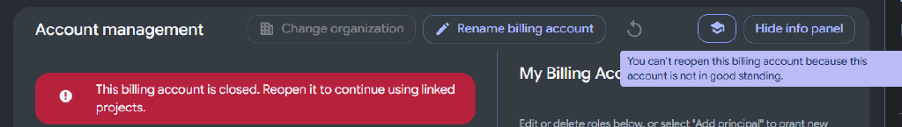
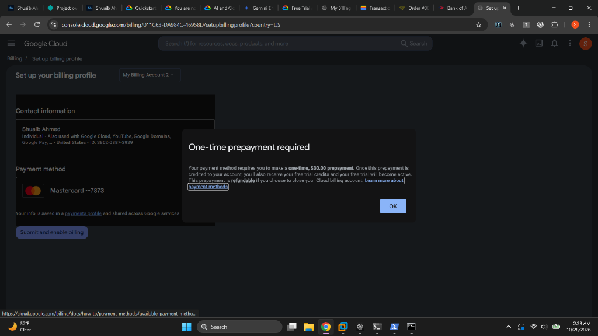
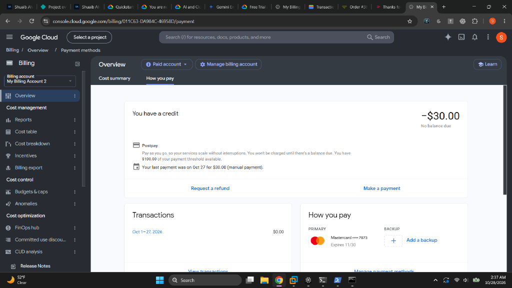
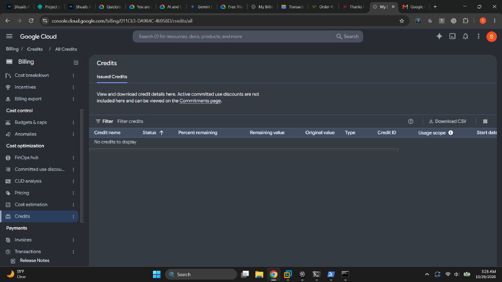
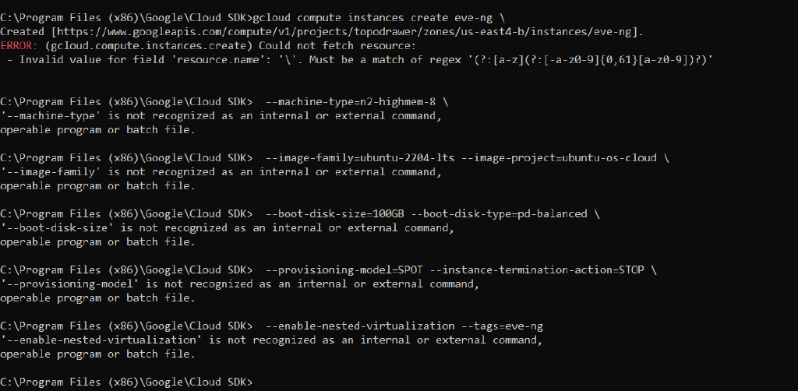
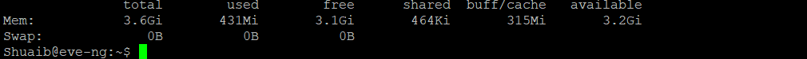
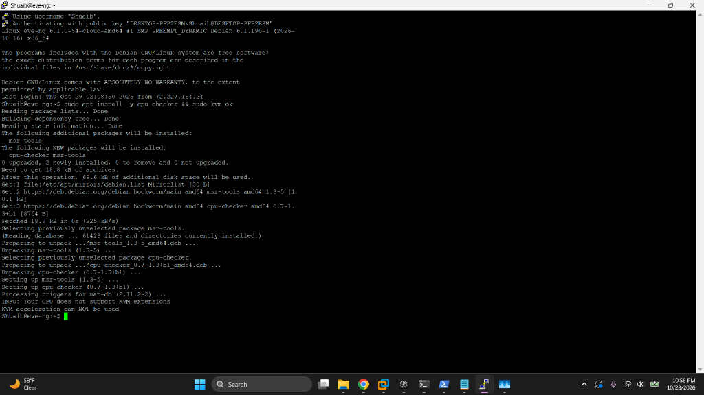
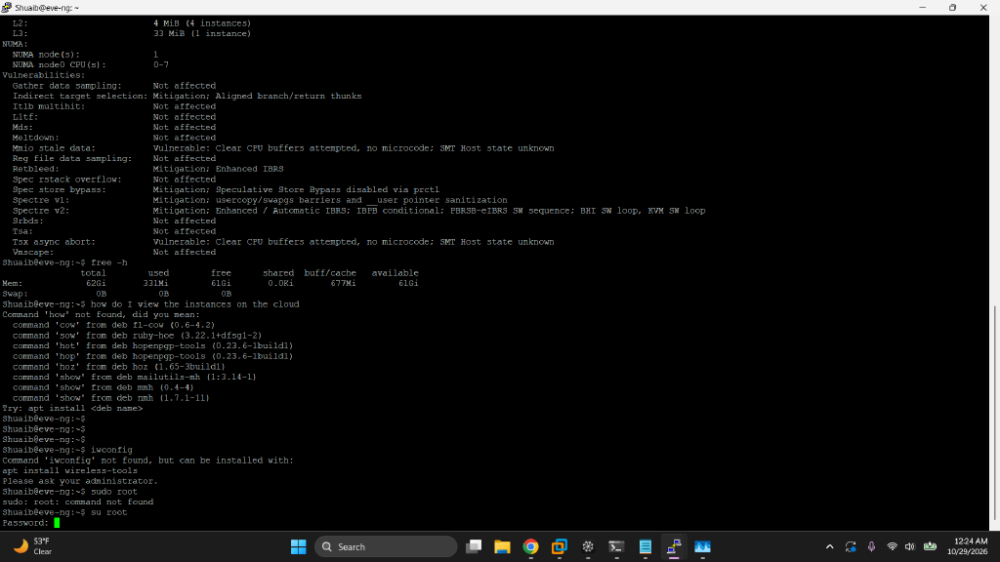
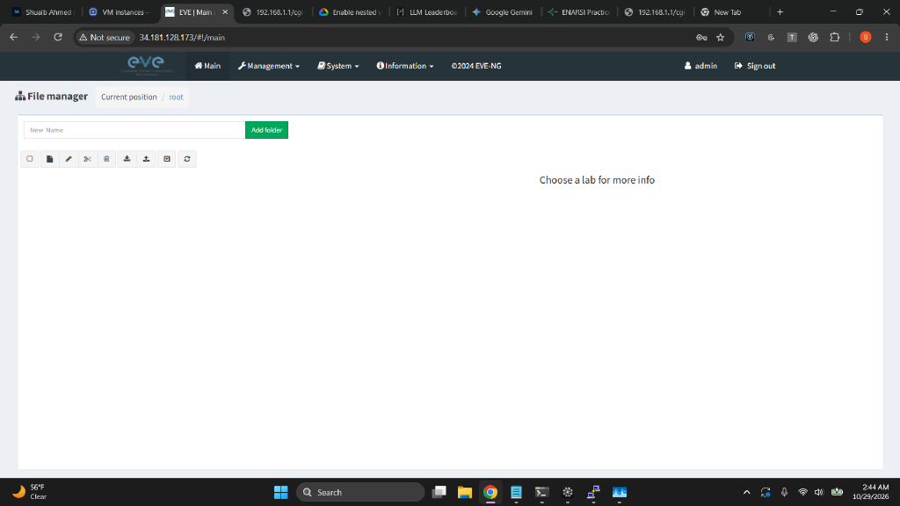

# Migrating EVE-NG from a Home Lab to Google Cloud

**Author:** Shuaib Ahmed
**Dates:** October 27–29, 2026
**Goal:** Host ~70 simulated network devices in the cloud for roughly $1/hour, then move a custom red-team/blue-team range platform (TopoDrawer) on top of it.

---

## 1. Executive summary

My home EVE-NG server (a physical box on my LAN) hits a hard RAM ceiling: ~10 running nodes is comfortable, ~15 is not. This project replaced that constraint with a rented Google Cloud VM sized for **70 IOSv-class nodes**, at Spot pricing of about **$0.20/hour**, secured with firewall rules that expose the lab to **my IP address only**.

The migration was not a single command — it was a campaign of small failures, each diagnosed and fixed in turn:

| Battle | Symptom | Root cause | Fix |
|---|---|---|---|
| Billing setup | `FAILED_PRECONDITION` on project link | Billing account self-closed after signup ("not in good standing") | New billing profile + verified card + one-time $30 prepayment |
| Instance sizing | `free -h` showed **3.6 GiB**, not 64 GB | Instance was created from console defaults, not the specified type | `set-machine-type` to `n2-highmem-8` on the stopped instance |
| Nested virtualization | `kvm-ok`: "KVM acceleration can NOT be used" | Nested virt can only be enabled **at instance creation** | Delete + recreate with `--enable-nested-virtualization` |
| Shell syntax | `gcloud` rejected multi-line create command | Bash `\` line-continuations pasted into `cmd.exe` | One-line command (or Git Bash) |
| PowerShell piping | `--rules=tcp:22,tcp:23,...` rejected | PowerShell splits bare comma-lists into separate arguments | Quote the value: `--rules="tcp:22,tcp:23,tcp:80,tcp:443"` |
| Web UI unreachable | Port 443 timed out from my network | Apache's SSL vhost not enabled after EVE-NG install | `a2enmod ssl && a2ensite default-ssl && restart` |
| Port 80 unreachable | Even plain HTTP timed out | Port 80 was **never in the firewall allow list** | Added `tcp:80` to the rule |
| SSH exposure | `default-allow-ssh` allowed port 22 from `0.0.0.0/0` | Google's network defaults | Deleted; replaced with IP-scoped rule + IAP rescue rule |

**End state:** EVE-NG Community Edition running on an Ubuntu 22.04 VM in `us-east4-b` (8 vCPU / 64 GB), web UI live on HTTPS at a static external IP, firewall locked to my IP, with the custom TopoDrawer adversarial layer as the next deployment phase.

---

## 2. Why move to the cloud

EVE-NG nodes are virtual machines, and RAM is the binding constraint:

| Node type | RAM per node | 70 nodes |
|---|---|---|
| Cisco IOSv (L3) | ~512 MB | ~35 GB |
| Cisco IOSvL2 (switching) | ~768 MB–1 GB | ~55–70 GB |
| CSR1000v | 3–4 GB | impractical at 70 nodes |

Add ~6–8 GB for the EVE-NG host itself. The home server cannot hold 64 GB of guest RAM; a rented cloud VM can.

**Instance selection:**

| Machine type | vCPU / RAM | On-demand $/hr | Verdict |
|---|---|---|---|
| `n2-highmem-8` | 8 / 64 GB | ~$0.55 | 70 × IOSv comfortable, ~50 × IOSvL2 max |
| `n2-highmem-16` | 16 / 128 GB | ~$1.05 | 70 × IOSvL2 without compromise |
| Spot variants | same | ~65% cheaper | GCP can evict with ~30 s warning |

**Chosen:** `n2-highmem-8` on Spot. The "N2" family matters because EVE-NG requires **nested virtualization**, which GCP supports on N1/N2/N2D/C2 families only — never on E2. The "highmem" skew toward RAM is exactly what 70 router VMs need.

Two flags make Spot survivable for lab work:

- `--provisioning-model=SPOT` — the discount
- `--instance-termination-action=STOP` — on preemption, **stop the VM instead of deleting it**, so disk, labs, and images survive

Combined real-world math: ~150 hours of 70-node labbing from a $30 credit; a stopped VM costs only its disk (~$9/month).

---

## 3. Target architecture

```
┌─────────────────────────── My Windows laptop (NYC) ───────────────────────────┐
│  Browser ──► EVE-NG web UI          TopoDrawer bridge (127.0.0.1:8766)         │
│  gcloud CLI ──► SSH / management    (re-pointed to the cloud VM)               │
└────────────┬──────────────────────────────────────┬───────────────────────────┘
             │ HTTPS 443 / SSH 22 / telnet 23       │ telnet 32769–32776 (node consoles)
             ▼                                      ▼
┌─────────────────── GCP VM "eve-ng" (us-east4-b, Spot, n2-highmem-8) ──────────┐
│  Ubuntu 22.04 LTS → EVE-NG Community Edition                                  │
│  /opt/unetlab: labs (.unl) + node images (addons/)                            │
│  70-node capacity: 62.8 Gi RAM usable after host overhead                     │
└───────────────────────────────────────────────────────────────────────────────┘
             ▲
             │  tar stream over SSH (migration)
┌────────────┴───────────────────────────────────────────────────────────────────┐
│  Home EVE-NG arena server (192.168.1.107, root/eve) — custom TopoDrawer layer  │
│  ISP_Failover_IPS.unl: red/blue rosters, SLA scoring, convergence streak       │
└────────────────────────────────────────────────────────────────────────────────┘
```

The home server stays online as a fallback during validation. Nothing on it is modified by the migration — the cloud VM is a *pull* target, not a replacement-by-force.

---

## 4. The billing campaign

### 4.1 The setup trap

GCP refuses to run *anything* on a project without a billing account attached — even free-tier resources. The first signup attempt produced a billing account that then **closed itself**:



The banner: *"This billing account is closed. Reopen it to continue using linked projects."* Attempting to link it to the project returned `FAILED_PRECONDITION` — which read like a permissions problem but was actually a dead account. Attempting to reopen it was denied:

> *"You can't reopen this billing account because this account is not in good standing."*

"Not in good standing" points below the billing account, at the **Google Payments profile** underneath it — almost always a failed card verification charge or a declined card during signup.

### 4.2 The recovery

1. Created a **new payments profile** at `pay.google.com` with a verified bank-issued Mastercard (prepaid/virtual cards routinely fail Google's verification and close the account again — that is what likely happened the first time).
2. GCP then required a **one-time $30.00 prepayment** to activate the trial on the new profile:



3. The $30 cleared and posted as spendable credit:



### 4.3 The outcome — honesty about the lost trial

After the prepayment cleared, the account status read **"Paid account"**, not "Free trial account." Checking Billing → Credits showed the verdict:



*"No credits to display."* The first signup attempt — the one that created the account that closed itself — had consumed the one-free-trial-per-person allowance. Google counts the attempt, not the outcome.

**Decision:** proceed without the trial. The $30 prepayment *became* spendable credit, which at Spot pricing buys ~150 hours of 70-node labbing. The free-trial money was a discount, not the plan. (Fallback resources for later: Azure for Students — $100/year, no card required, renewable — is a portable hedge for any cloud, since Ubuntu + KVM + EVE-NG is cloud-agnostic.)

**Billing lessons worth keeping:**

- A `FAILED_PRECONDITION` on `billing projects link` can mean "account is closed," not "check your IAM roles" — read the account state before reading the error.
- Card verification is the fragile link in the whole chain. A real bank card is near-mandatory.
- Billing accounts have states (open / closed / not in good standing); check the banner, not just the API error.

---

## 5. Shell lessons (the tax paid for cross-shell work)

The migration was driven from Windows, across three different shells — each with its own breaking behavior:

### 5.1 Bash line-continuations pasted into cmd.exe

A multi-line `gcloud compute instances create` with trailing backslashes (`\`) — normal bash style — executed line-by-line garbage in `cmd.exe`, which has no line continuations:



The first line ran with a trailing `\` baked into the instance name (regex error on `resource.name`), and every subsequent `--flag` line was executed as its own phantom command. Fix: run the create as a **single line** in cmd, or use Git Bash for continuation syntax.

### 5.2 PowerShell splits bare comma-lists

```powershell
gcloud compute firewall-rules update eve-ng-lab --rules=tcp:22,tcp:23,tcp:80,tcp:443
```

PowerShell parses `a,b,c` as an **array** and hands gcloud four separate arguments. gcloud then re-joined them with spaces and rejected the result:

```
Firewall rules must be of the form PROTOCOL[:PORT[-PORT]]; received [tcp:22 tcp:23 tcp:80 tcp:443]
```

Note the spaces where commas should be — the tell that the shell rewrote the argument. Fix: quote it:

```powershell
gcloud compute firewall-rules update eve-ng-lab --rules="tcp:22,tcp:23,tcp:80,tcp:443"
```

### 5.3 Copy-paste truncation of long IDs

Billing account IDs are 18 characters in three 6-character groups (`011C63-DA984C-4695BB` style). Several failures came from pasting a 17-character prefix. The durable fix is to stop retyping IDs and let the CLI print them:

```bash
gcloud billing accounts list
```

…and copy from the source of truth. Even better, keep the human out of the loop entirely:

```powershell
$acct = (gcloud billing accounts list --format="value(name)" | Select-String "011C63").ToString()
gcloud billing projects link topodrawer --billing-account=$acct.Split("/")[-1]
```

### 5.4 Finding the SDK at all

The Google Cloud SDK for Windows installs to:

```
C:\Program Files (x86)\Google\Cloud SDK\google-cloud-sdk\bin
```

`gcloud` is not a separate application — it is a command that any terminal (cmd, PowerShell, Git Bash) runs after that `bin` folder is on the `PATH`. Environment-variable changes require **reopening the terminal**; existing shells never re-read the PATH.

---

## 6. Building the VM — and fixing it twice

### 6.1 The create command, flag by flag

```bash
gcloud compute instances create eve-ng \
  --machine-type=n2-highmem-8 \
  --image-family=ubuntu-2204-lts --image-project=ubuntu-os-cloud \
  --boot-disk-size=100GB --boot-disk-type=pd-balanced \
  --provisioning-model=SPOT \
  --instance-termination-action=STOP \
  --enable-nested-virtualization \
  --tags=eve-ng
```

| Flag | Why it matters |
|---|---|
| `--machine-type=n2-highmem-8` | 8 vCPU / 64 GB, RAM-skewed family |
| `--image-family=ubuntu-2204-lts` | clean, current OS template; EVE-NG CE targets Jammy |
| `--provisioning-model=SPOT` | ~65% discount, eviction possible |
| `--instance-termination-action=STOP` | preemption stops the VM instead of deleting it — lab state survives |
| `--enable-nested-virtualization` | **the load-bearing flag** — exposes hardware virtualization to the guest so `/dev/kvm` exists and EVE-NG can spawn nodes |
| `--tags=eve-ng` | lets firewall rules target the lab VM by role |

### 6.2 Failure #1 — the wrong machine

The first instance came up as something else entirely (console defaults: small machine, Debian, no nested virt):



`free -h` showing 3.6 GiB total on a machine specced at 64 GB is an instant mismatch flag. Diagnosis:

```bash
gcloud compute instances describe eve-ng --format="value(machineType)"
```

### 6.3 Failure #2 — no nested virtualization

After resizing, the virtualization check failed:



```
INFO: Your CPU does not support KVM extensions.
KVM acceleration can NOT be used.
```

`kvm-ok` (from the `cpu-checker` package) interrogates the CPU flags from inside the guest. This is the check to run **before** installing EVE-NG — EVE-NG installs happily onto a non-virtualized host and then fails at every node boot, which wastes hours of symptom-chasing.

The structural fact that forced a recreate: **nested virtualization can only be enabled at instance creation.** It is attached to the boot disk as a license at create time; there is no post-creation toggle. The instance was 40 minutes old with a stock OS on it — cheaper to delete than to argue with.

### 6.4 The resize (Branch A)

Between the two failures, the machine-type itself was fixed the cheap way — a hot-swap on a stopped instance:

```bash
gcloud compute instances stop eve-ng --zone=us-east4-b
gcloud compute instances set-machine-type eve-ng --machine-type=n2-highmem-8 --zone=us-east4-b
gcloud compute instances start eve-ng --zone=us-east4-b
```

`set-machine-type` only works on a **stopped** instance; the disk and contents are untouched — the hardware underneath changes.

### 6.5 The proof

After the final recreate, both gates passed:



- `free -h` → **62Gi** (64 GB minus kernel reserve)
- `lscpu` → **CPU(s): 8**
- `/dev/kvm` present: `crw-rw---- 1 root kvm 10, 232` — hardware virtualization exposed to the guest

**The rule of the section: verify the foundation with read-only commands before building anything on it.** Every later failure in this project was diagnosed faster because the checks were already habitual.

---

## 7. Nested virtualization, precisely

The stack, in three layers:

```
Google's physical server (Xeon, hardware VT-x)
  └── GCP hypervisor (your VM is a guest here)
        └── your Ubuntu VM ("eve-ng")
              └── KVM (/dev/kvm) → EVE-NG nodes: IOSv, IOSvL2, QEMU images
```

Normally a hypervisor hides the CPU's virtualization extensions from its guests — a guest cannot itself be a hypervisor. The `--enable-nested-virtualization` flag makes GCP pass VT-x *through* to the guest. From inside, `ls /dev/kvm` either exists (nested virt works) or it does not (nothing EVE-NG does afterwards will matter). One flag decides the entire architecture.

---

## 8. Firewall architecture

Final rule set (verified with `gcloud compute firewall-rules list`):

| Rule | Direction | Allows | Sources | Purpose |
|---|---|---|---|---|
| `eve-ng-lab` | INGRESS, priority 1000 | tcp:22, 23, 80, 443 | `72.227.164.24/32` | Human access: SSH, EVE console proxy, HTTP, HTTPS |
| `eve-ng-consoles` | INGRESS, priority 1000 | tcp:32768–32999 | `72.227.164.24/32`, target tag `eve-ng` | Node consoles for the TopoDrawer arena bridge |
| `allow-iap-ssh` | INGRESS | tcp:22 | `35.235.240.0/20` | **Rescue path** — Google IAP range; requires Google authentication to use |
| `default-allow-internal` | INGRESS | all tcp/udp/icmp | `10.128.0.0/9` | GCP-internal plumbing (untouched) |
| ~~`default-allow-ssh`~~ | — | ~~tcp:22 from 0.0.0.0/0~~ | — | **Deleted** — the internet-wide default shadowed by the scoped rule |
| ~~`default-allow-rdp`~~ | — | — | — | Deleted (Linux VM) |

Three principles that fell out of this work:

1. **ALLOW rules stack; they don't subtract.** Each rule only *adds* permitted traffic. The implicit deny applies only when no rule allows. A rule allowing ports 32768–32999 cannot "block" 443 — 443 is allowed by a different rule in the union.
2. **The internet-wide default was the real exposure.** `default-allow-ssh` (port 22 from `0.0.0.0/0`) existed alongside the scoped rule and quietly made the scoped rule pointless. Deleting it was the actual security upgrade — scoped rules only matter when the wide one is gone.
3. **Rotating home IP = rotating lock.** The ISP cycles DHCP leases; when the public IP changes, every IP-scoped rule locks out silently. The IAP rule (`35.235.240.0/20`) exists precisely for that moment: IAP routes SSH through Google's authenticated API instead of open ports, so a rotated IP costs a re-run of one command, not the lab.

---

## 9. Installing EVE-NG Community on Ubuntu 22.04

### 9.1 Finding the real source

The first attempts failed on DNS: neither `install.eve-ng.net` nor `apt.repos.eve-ng.net` resolve — from the VM, using Google's own resolver. That was the tell that remembered-but-unverified repo paths were stale.

The authoritative source turned out to be EVE-NG's own infrastructure: the official jammy update script at `https://www.eve-ng.net/jammy/update-eve-ce.sh`, read line-by-line before running anything. Two facts extracted from it:

- The CE repository for Ubuntu 22.04 is hosted at **`http://www.eve-ng.net/jammy`**
- The signing key is **`http://www.eve-ng.net/jammy/eczema@ecze.com.gpg.key`**

### 9.2 The install

```bash
sudo -i
apt-get update && apt-get -y upgrade
apt-get -y install gnupg

# Trust EVE-NG's signing key (verify before trusting — the script above is the source of both URLs)
wget -O - http://www.eve-ng.net/jammy/eczema@ecze.com.gpg.key | gpg --dearmor -o /etc/apt/trusted.gpg.d/eve-ng.gpg

# Add the repo
echo "deb [arch=amd64] http://www.eve-ng.net/jammy jammy main" > /etc/apt/sources.list.d/eve-ng.list
apt-get update

# Confirm the package is visible before installing
apt-cache policy eve-ng

# Install (10–20 minutes)
DEBIAN_FRONTEND=noninteractive apt-get -y install eve-ng
```

Two commands in that block deserve their own explanation:

- **`wget -O -`** downloads the file and prints it to **stdout** instead of saving it — the dash means "standard output." The key file never touches the disk; it flows straight into the next command.
- **`gpg --dearmor`** converts the key from ASCII-armored text (the `-----BEGIN PGP PUBLIC KEY BLOCK-----` form) into the binary keyring format APT requires under `/etc/apt/trusted.gpg.d/`.

Why both steps exist at all: APT refuses packages from a repository it cannot verify. The key lets `apt` cryptographically prove every `eve-ng` package came from EVE-NG's server and was not tampered with in transit. Trust, but verify — literally.

`apt-cache policy eve-ng` before `apt-get install` is the cheap gate: if the package is not visible, the repo or the key is broken, and installing would fail anyway.

### 9.3 The one step that can brick the VM

The EVE-NG package rebuilds networking around a Linux bridge, `pnet0`, and assumes the primary NIC is named `eth0`. GCP's NIC is named `ens4`. Rebooting with the bridge pointed at a nonexistent interface = a VM with no network = a VM you cannot SSH into.

The fix, **before** rebooting:

1. Identify the real NIC: `ip -o link` → `ens4`
2. Edit `/etc/network/interfaces`:
   ```
   auto pnet0
   iface pnet0 inet dhcp
       bridge_ports ens4
       bridge_stp off
   ```
3. Stop GCP's cloud-init from fighting EVE-NG over network config:
   ```bash
   echo 'network: {config: disabled}' > /etc/cloud/cloud.cfg.d/99-disable-network-config.cfg
   ```
4. Rescue insurance: enable **Serial port 1** on the VM in the console *before* rebooting. If networking dies anyway, the serial console still reaches the machine.

Verification after reboot: `ip -br addr` shows `pnet0` holding the VM's internal IP (`10.150.0.3`) with `ens4` enslaved and unaddressed.

*(Field note: `iwconfig` is for Wi-Fi only — "no wireless extensions" on a headless cloud VM is normal and tells you nothing about the bridge. The wired checks are `ip -br addr` and `ip -br link`.)*

---

## 10. Debugging the web service — three false friends

After install, the web UI was unreachable. The path to the truth ran through three checks, each isolating one layer:

### 10.1 Is anything listening? (inside the VM)

```bash
sudo ss -tlnp | grep -E ':(80|443)\s'
```

Result: `apache2` on **port 80 only**. EVE-NG's package ships with Apache's SSL engine and default-SSL site **disabled**; HTTPS is opt-in:

```bash
sudo a2enmod ssl && sudo a2ensite default-ssl && sudo systemctl restart apache2
```

### 10.2 Is the port reachable from outside? (from the laptop)

```powershell
curl.exe -kI https://34.181.128.173     # -k ignores the self-signed cert
Test-NetConnection 34.181.128.173 -Port 443
```

### 10.3 The counterintuitive finding — port 80

Port 443 was now listening *and* firewall-allowed… and plain **HTTP on port 80 still timed out**. The reason: **port 80 was never in the firewall rule's allow list.** The rule allowed 22, 23, 443. Traffic to 80 hit the implicit deny, no matter how healthy Apache was. The fix was a rule update (with the PowerShell quoting from §5.2):

```powershell
gcloud compute firewall-rules update eve-ng-lab --rules="tcp:22,tcp:23,tcp:80,tcp:443"
```

**Layer-isolation summary:**

| Symptom | Layer responsible | Evidence |
|---|---|---|
| 443 unreachable | Apache config (service) | `ss` showed no 443 listener |
| 80 unreachable | VPC firewall (network) | port absent from rule's ALLOW list |
| SSH fine throughout | — | proved the path itself was good |

One incident, two different layers, zero overlap between them — and only the inside-the-VM check could tell them apart.

### 10.4 Testing a web port vs. "ping"

`ping` uses ICMP and has no concept of ports. To test a web port:

```powershell
Test-NetConnection 34.181.128.173 -Port 443    # raw TCP reachability
curl.exe -kI https://34.181.128.173            # the web service actually answering
```

---

## 11. IPs: ephemeral vs. reserved

The VM's external address has two possible lifetimes:

- **Ephemeral** — assigned at start, released on stop. With a daily start/stop habit, the IP changes every morning: the browser bookmark, the bridge config, and the notes all rot daily.
- **Reserved (static)** — allocated once and attached; survives stop/start. Costs a few dollars/month while attached (less while detached).

The workflow that emerged:

```bash
gcloud compute addresses create eve-ng-ip --region=us-east4
gcloud compute instances add-access-config eve-ng --zone=us-east4-b \
  --address=$(gcloud compute addresses describe eve-ng-ip --region=us-east4 --format="value(address)")
```

Two traps encountered and disarmed:

- **"At most one access config currently supported"** — the VM already had an external-IP access config; adding a second is rejected. The fix is *replace*, not *add* (`delete-access-config`, then `add-access-config` with the reserved address).
- **`--address` wants the numeric IP, not the resource name.** The sub-shell `$(gcloud ... describe ... --format="value(address)")` resolves the name to the number automatically.

A blank external IP on a stopped VM is also normal — the describe command simply returns nothing for `natIP` until the instance runs.

---

## 12. Access model: no root password, by design

GCP VMs ship with **no root password**. The root account is locked; SSH password logins for root are disabled. Access is by SSH key (gcloud generates and installs one on first `gcloud compute ssh`) plus passwordless sudo via the `google-sudoers` group.

The working pattern:

```bash
sudo <command>    # one privileged command
sudo -i           # full root shell
```

This is a feature, not an obstacle: an internet-facing VM with a password-authenticated root account is a botnet recruitment target within days. Key-based access with locked password auth is the hardening every cloud instance should start with.

---

## 13. Verification gates (the discipline)

Every stage of this build ended in a named gate with a pass condition — no step was trusted because it "should have worked":

| Gate | Check | Pass condition |
|---|---|---|
| Billing | `gcloud billing projects describe topodrawer` | `billingEnabled: true` |
| Compute API | `gcloud services list --enabled` | `compute.googleapis.com` present |
| VM specs | `free -h`, `lscpu` | ~62.8 Gi, 8 CPUs |
| Nested virt | `ls /dev/kvm`, `kvm-ok` | device exists; "KVM acceleration can be used" |
| Bridge | `ip -br addr` | `pnet0` holds the IP, `ens4` enslaved |
| Web stack | `ss -tlnp` | apache2 on 80 **and** 443 |
| Path | `curl -kI` from laptop | HTTP 200/302 |
| Web UI | browser login | `admin/eve` accepted, dashboard renders |

## 14. Current state



EVE-NG Community Edition, logged in and live at `https://34.181.128.173` — the File Manager shows a clean `/root` lab directory on the fresh install. Base layer complete.

**Next phases:**

1. Stream images + labs from the home arena box (`192.168.1.107`) — `tar` over an SSH pipe, files never touching the local disk
2. `unl_wrapper -a fixpermissions` so EVE-NG's service account owns the copied files
3. Deploy the custom TopoDrawer layer via the self-contained `eve_standalone_installer.py`
4. Re-point the arena bridge (`127.0.0.1:8766`) from `192.168.1.107` to the cloud IP
5. First cloud-hosted red/blue round — same rosters, same SLA scoring, 70-node headroom

## 15. Lessons learned

1. **Read errors as state, not as blame.** `FAILED_PRECONDITION` meant "account closed," `IAM_PERMISSION_DENIED` meant "truncated ID," and "at most one access config" meant "already attached." None of them meant what they seemed to say on the surface.
2. **Verify the foundation before building on it.** `kvm-ok` before EVE-NG, `free -h` before anything. The 40-minute-old wrong instance was cheaper to delete than to repair.
3. **One flag can be the whole architecture.** `--enable-nested-virtualization` is the difference between a lab platform and an empty Ubuntu box. `--instance-termination-action=STOP` is the difference between an eviction and a data-loss incident.
4. **Know which shell you are in.** The same command fragment is a continuation in bash, garbage in cmd, and an argument-splitting surprise in PowerShell. Cross-shell work has a syntax tax — pay it consciously.
5. **Firewalls are unions of allows.** Adding rules cannot "block" something another rule allows; and deleting the wide default (`0.0.0.0/0` SSH) is what makes the scoped rule real.
6. **Cloud-init will fight your network config** unless explicitly disabled on appliances that manage their own bridges.
7. **The copy-paste layer is a real attack surface** for your own productivity: 17-character billing IDs, mangled quotes, mid-paste truncations. Automate the ID plumbing; keep humans on decisions.
8. **A lost free trial is a discount lost, not a project lost.** The plan survives on $30 of Spot credit — because the plan was priced at ~$0.20/hour in the first place.

---

*All testing performed against the author's own isolated cloud VM and home lab equipment. No third-party systems were accessed at any point.*
