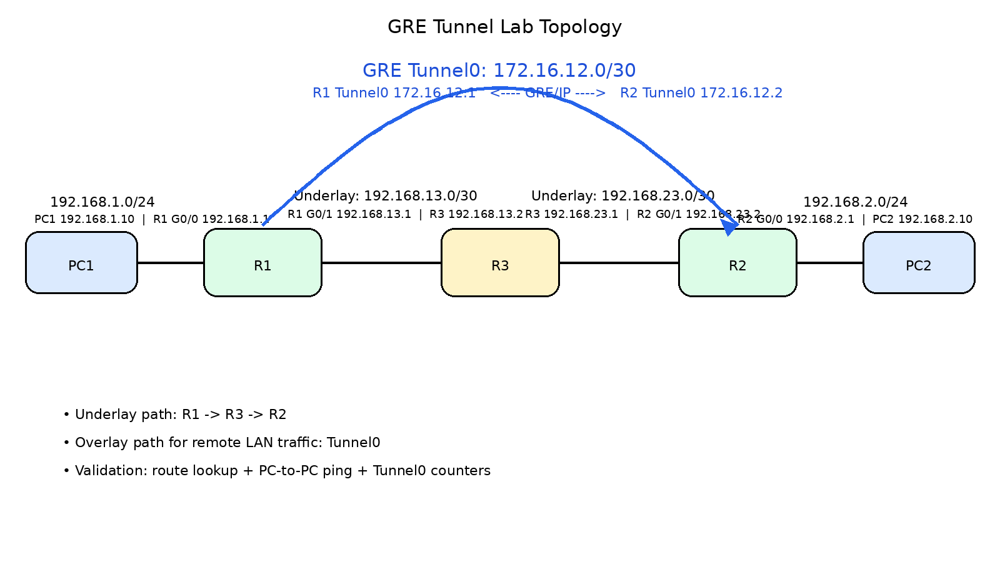
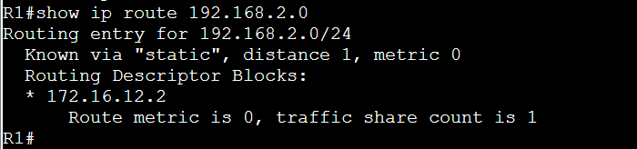
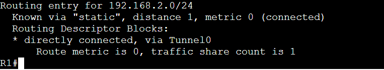
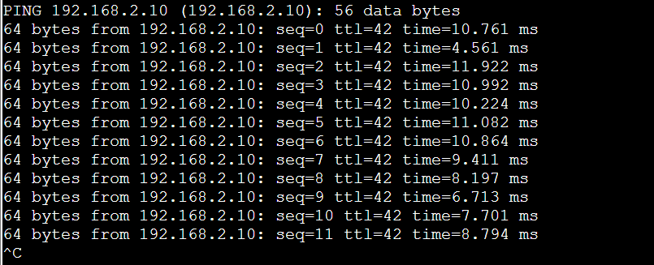
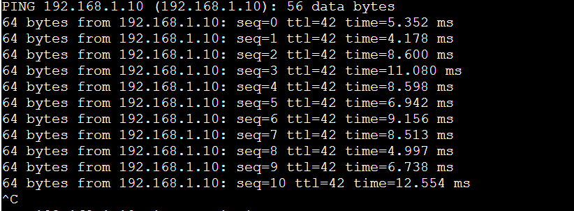
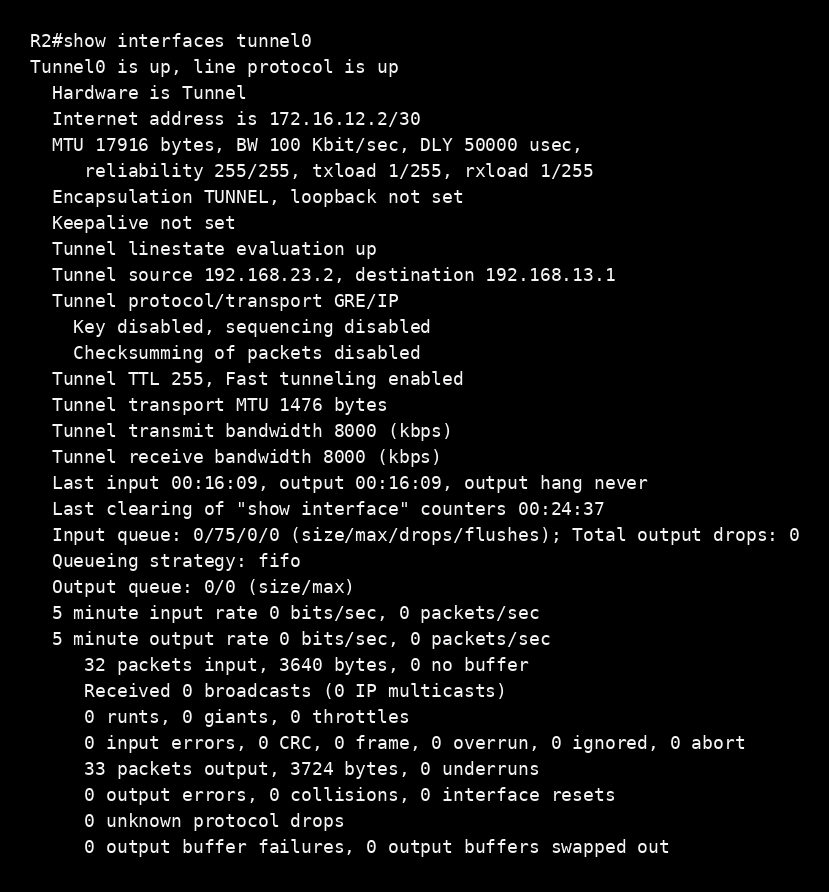

# Configuring GRE

## Lab Objective

This lab builds and validates a GRE tunnel between **R1** and **R2** across an intermediate routed underlay (**R3**). The validation sequence is intentionally split into two parts:

1. **Underlay reachability** — prove the physical IP path exists.
2. **Overlay validation** — prove remote LAN traffic is actually forwarded through **Tunnel0** and not simply through the ordinary underlay route.

This lab does **not** use OSPF yet. That is the next phase. The purpose here is to show GRE cleanly from beginning to end.

---

## What this lab proves

- The underlay provides the real routed path: **R1 -> R3 -> R2**
- GRE creates a logical overlay between **R1** and **R2**
- A static route can force remote LAN traffic into **Tunnel0**
- Interface counters on both tunnel interfaces increase during PC-to-PC traffic, proving GRE encapsulation/decapsulation is actually happening

---

## Topology



---

## Addressing Plan

### End Hosts
| Device | Interface | IP Address | Mask | Default Gateway |
|---|---|---:|---:|---:|
| PC1 | eth0 | 192.168.1.10 | /24 | 192.168.1.1 |
| PC2 | eth0 | 192.168.2.10 | /24 | 192.168.2.1 |

### Router LAN Interfaces
| Device | Interface | IP Address | Mask |
|---|---|---:|---:|
| R1 | G0/0 | 192.168.1.1 | /24 |
| R2 | G0/0 | 192.168.2.1 | /24 |

### Underlay
| Link | Network | Endpoints |
|---|---|---|
| R1 - R3 | 192.168.13.0/30 | R1 G0/1 = 192.168.13.1, R3 = 192.168.13.2 |
| R3 - R2 | 192.168.23.0/30 | R3 = 192.168.23.1, R2 G0/1 = 192.168.23.2 |

### GRE Overlay
| Device | Interface | IP Address | Mask |
|---|---|---:|---:|
| R1 | Tunnel0 | 172.16.12.1 | /30 |
| R2 | Tunnel0 | 172.16.12.2 | /30 |

---

## Phase 1 — Build the underlay

The GRE tunnel cannot function until the physical tunnel source and destination are reachable.

### R1
```cisco
hostname R1
!
interface GigabitEthernet0/0
 ip address 192.168.1.1 255.255.255.0
 no shutdown
!
interface GigabitEthernet0/1
 ip address 192.168.13.1 255.255.255.252
 no shutdown
!
ip route 192.168.23.0 255.255.255.252 192.168.13.2
```

### R3
```cisco
hostname R3
!
interface GigabitEthernet0/0
 ip address 192.168.13.2 255.255.255.252
 no shutdown
!
interface GigabitEthernet0/1
 ip address 192.168.23.1 255.255.255.252
 no shutdown
!
ip route 192.168.1.0 255.255.255.0 192.168.13.1
ip route 192.168.2.0 255.255.255.0 192.168.23.2
```

### R2
```cisco
hostname R2
!
interface GigabitEthernet0/0
 ip address 192.168.2.1 255.255.255.0
 no shutdown
!
interface GigabitEthernet0/1
 ip address 192.168.23.2 255.255.255.252
 no shutdown
!
ip route 192.168.13.0 255.255.255.252 192.168.23.1
```

### Why these routes exist
At this stage, the only requirement is that:
- **R1** can reach **192.168.23.2**
- **R2** can reach **192.168.13.1**

That is enough for GRE tunnel source/destination reachability.

---

## Phase 2 — Configure the GRE tunnel

### R1
```cisco
interface Tunnel0
 ip address 172.16.12.1 255.255.255.252
 tunnel source 192.168.13.1
 tunnel destination 192.168.23.2
```

### R2
```cisco
interface Tunnel0
 ip address 172.16.12.2 255.255.255.252
 tunnel source 192.168.23.2
 tunnel destination 192.168.13.1
```

### Verification
```cisco
show interfaces tunnel0
```

Expected result:
- `Tunnel0 is up, line protocol is up`

---

## Phase 3 — Show that the remote LAN is *not* using GRE yet

Before forcing traffic into the overlay, R1 had a plain static route to the remote LAN via the underlay next hop.

### Evidence: route via underlay


Interpretation:
- The route to `192.168.2.0/24` was still expressed as a **static next-hop route**
- At that checkpoint, the forwarding path was not yet stated explicitly as `via Tunnel0`
- For this lab, the route was then rewritten so the overlay path would be operationally unambiguous

Operationally, this was the point where GRE existed, but remote-LAN forwarding had not yet been made explicit through the tunnel interface itself.

---

## Phase 4 — Force the remote LAN through GRE

Replace the remote-LAN route so it exits through the tunnel interface.

### R1
```cisco
no ip route 192.168.2.0 255.255.255.0 172.16.12.2
ip route 192.168.2.0 255.255.255.0 Tunnel0
```

### R2
```cisco
ip route 192.168.1.0 255.255.255.0 Tunnel0
```

### Evidence: route via Tunnel0


Interpretation:
- `192.168.2.0/24` is now **directly connected, via Tunnel0**
- That means the forwarding decision for the remote LAN now enters the GRE overlay

This is the critical routing-table checkpoint in the lab.

---

## Phase 5 — Configure the Linux desktops

These end hosts are **not VPCS**, so the host configuration is done with standard Linux commands.

### PC1
```bash
ip addr add 192.168.1.10/24 dev eth0
ip route add default via 192.168.1.1
```

### PC2
```bash
ip addr add 192.168.2.10/24 dev eth0
ip route add default via 192.168.2.1
```

### Notes
- There is no Cisco-style `write memory` for these Linux desktops
- Interface configuration is runtime state unless you make it persistent in the guest OS
- For this lab, runtime configuration is sufficient

---

## Phase 6 — Capture tunnel counters before testing

Before the PC-to-PC ping test, both tunnels were checked.

### R1 before traffic


Key values:
- Input packets: **10**
- Output packets: **10**

### R2 before traffic


Key values:
- Input packets: **10**
- Output packets: **10**

These values establish the pre-test baseline.

---

## Phase 7 — Generate traffic across the GRE tunnel

### PC1 to PC2


### PC2 to PC1


What this proves by itself:
- End-to-end reachability exists between the two LANs

What it does **not** prove by itself:
- Whether the traffic used the GRE overlay or just ordinary underlay forwarding

That is why the tunnel counters are checked again immediately afterward.

---

## Phase 8 — Validate tunnel counters after traffic

### R1 after traffic


Key values:
- Input packets: **33**
- Output packets: **33**

### R2 after traffic


Key values:
- Input packets: **32**
- Output packets: **33**

---

## Final validation logic

### Before traffic
- R1 Tunnel0: **10 in / 10 out**
- R2 Tunnel0: **10 in / 10 out**

### After traffic
- R1 Tunnel0: **33 in / 33 out**
- R2 Tunnel0: **32 in / 33 out**

### Conclusion
The tunnel counters increased materially on both routers during the PC-to-PC ping test. That means:

1. Traffic was **encapsulated into GRE**
2. Carried across the underlay
3. **Decapsulated on the far router**
4. Forwarded to the remote LAN host

This validates that the remote LAN traffic was using **Tunnel0** as intended.

The underlay still matters:
- It is still the real transport path
- GRE does not remove the physical route through **R3**

But the forwarding decision for the remote LAN was now through the **overlay**

---

## Technical interpretation

### Underlay
The underlay is the real routed transport:
- `R1 -> R3 -> R2`

### Overlay
GRE creates a logical point-to-point relationship between:
- `R1 Tunnel0`
- `R2 Tunnel0`

### Why GRE matters here
GRE did **not** improve:
- speed
- bandwidth
- raw stability

The value shown by this lab is:
- logical abstraction
- cleaner routed overlay behavior
- a clean foundation for running a dynamic routing protocol over the tunnel in the next phase

---

## Key takeaway

This lab demonstrates the exact difference between:

- **Underlay transport** — the real routed path through intermediate devices
- **Overlay forwarding** — the logical tunnel-based path used for remote LAN traffic

That distinction is the whole point of learning GRE correctly.

---

## Next step

The next lab phase is **OSPF over GRE**.

That is where GRE becomes more operationally meaningful, because the tunnel stops being just a manually used overlay and becomes a logical link over which a routing protocol can form adjacency and dynamically exchange routes.

