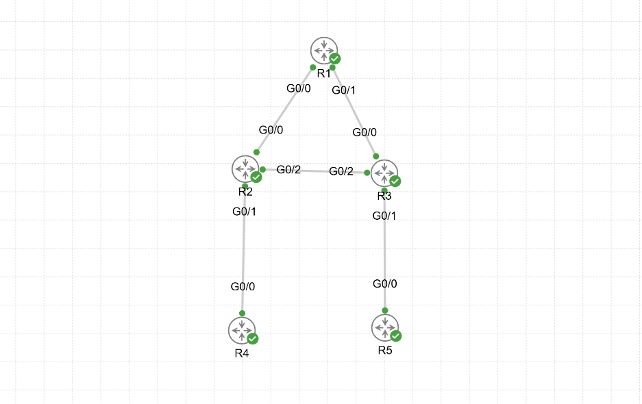
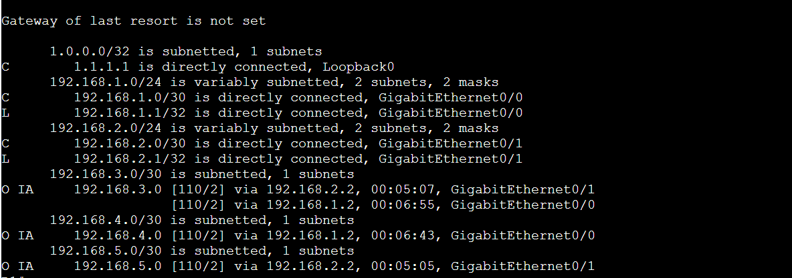
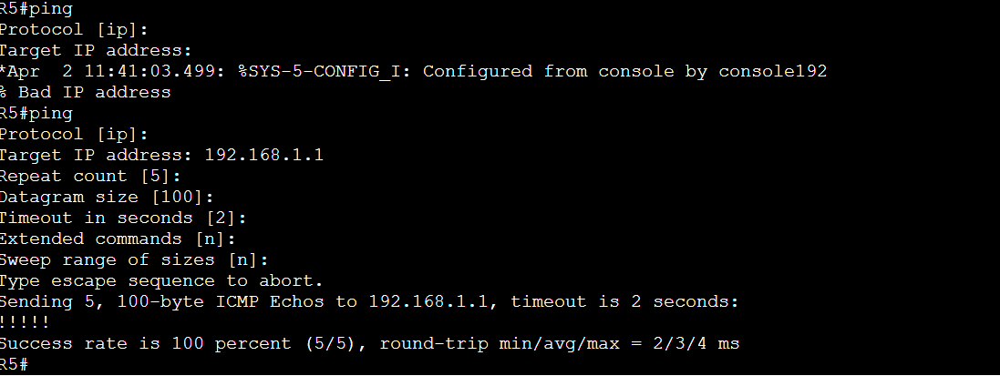
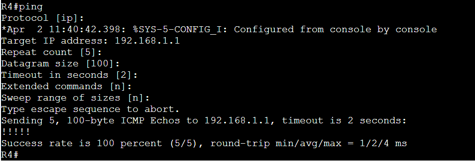

# Multi-Area OSPF Lab

## Overview

This lab demonstrates a basic **multi-area OSPF design** in Cisco CML using five IOSv routers.  
The topology uses:

- **Area 0** as the backbone
- **Area 10** as a non-backbone area behind **R2**
- **Area 20** as a non-backbone area shared by **R2, R3, and R5**
- **R2** and **R3** as **ABRs** because they each connect Area 0 to another area

The lab verifies that inter-area routes are learned correctly as **O IA** routes and that routers in non-backbone areas can still reach backbone-connected networks through the ABRs.

---

## CCNP ENCOR Relevance

This lab supports the following CCNP Enterprise topics:

- Multi-area OSPF design and operation
- ABR behavior
- Inter-area route propagation
- OSPF adjacency formation across different areas
- Interpreting the routing table for **intra-area** vs **inter-area** reachability

This maps directly to the routing section of ENCOR where you must understand and implement OSPF concepts beyond single-area deployments.

---

## Topology



### Logical Roles

- **R1**: Backbone router in **Area 0**
- **R2**: ABR between **Area 0**, **Area 10**, and **Area 20**
- **R3**: ABR between **Area 0** and **Area 20**
- **R4**: Internal router in **Area 10**
- **R5**: Internal router in **Area 20**

---

## Addressing Plan

| Link | Network |
|---|---|
| R1 G0/0 ↔ R2 G0/0 | 192.168.1.0/30 |
| R1 G0/1 ↔ R3 G0/0 | 192.168.2.0/30 |
| R2 G0/2 ↔ R3 G0/2 | 192.168.3.0/30 |
| R2 G0/1 ↔ R4 G0/0 | 192.168.4.0/30 |
| R3 G0/1 ↔ R5 G0/0 | 192.168.5.0/30 |

### Loopbacks / Router IDs

| Router | Loopback | Router ID |
|---|---|---|
| R1 | 1.1.1.1 | 1.1.1.1 |
| R2 | 2.2.2.2 | 2.2.2.2 |
| R3 | 3.3.3.3 | 3.3.3.3 |
| R4 | 4.4.4.4 | 4.4.4.4 |
| R5 | 5.5.5.5 | 5.5.5.5 |

> Note: In the live build transcript, **R2 loopback** was entered as `2.2.2.2 255.255.255.252`.  
> The router ID was still explicitly set to `2.2.2.2`, so OSPF operation for the lab remained valid.

---

## Area Assignment

| Router | Interface | Area |
|---|---|---|
| R1 | G0/0 | 0 |
| R1 | G0/1 | 0 |
| R2 | G0/0 | 0 |
| R2 | G0/1 | 10 |
| R2 | G0/2 | 20 |
| R3 | G0/0 | 0 |
| R3 | G0/1 | 20 |
| R3 | G0/2 | 20 |
| R4 | G0/0 | 10 |
| R5 | G0/0 | 20 |

---

## Device Configurations

### R1

```cisco
hostname R1
no ip domain-lookup

interface g0/0
 ip address 192.168.1.1 255.255.255.252
 no shutdown

interface g0/1
 ip address 192.168.2.1 255.255.255.252
 no shutdown

interface loopback0
 ip address 1.1.1.1 255.255.255.255

router ospf 1
 router-id 1.1.1.1

interface g0/0
 ip ospf 1 area 0

interface g0/1
 ip ospf 1 area 0
```

### R2

```cisco
hostname R2
no ip domain-lookup

interface g0/0
 ip address 192.168.1.2 255.255.255.252
 no shutdown

interface g0/1
 ip address 192.168.4.1 255.255.255.252
 no shutdown

interface g0/2
 ip address 192.168.3.1 255.255.255.252
 no shutdown

interface loopback0
 ip address 2.2.2.2 255.255.255.252

router ospf 1
 router-id 2.2.2.2

interface g0/0
 ip ospf 1 area 0

interface g0/1
 ip ospf 1 area 10

interface g0/2
 ip ospf 1 area 20
```

### R3

```cisco
hostname R3
no ip domain-lookup

interface g0/0
 ip address 192.168.2.2 255.255.255.252
 no shutdown

interface g0/1
 ip address 192.168.5.1 255.255.255.252
 no shutdown

interface g0/2
 ip address 192.168.3.2 255.255.255.252
 no shutdown

interface loopback0
 ip address 3.3.3.3 255.255.255.255

router ospf 1
 router-id 3.3.3.3

interface g0/0
 ip ospf 1 area 0

interface g0/1
 ip ospf 1 area 20

interface g0/2
 ip ospf 1 area 20
```

### R4

```cisco
hostname R4
no ip domain-lookup

interface g0/0
 ip address 192.168.4.2 255.255.255.252
 no shutdown

interface loopback0
 ip address 4.4.4.4 255.255.255.255

router ospf 1
 router-id 4.4.4.4

interface g0/0
 ip ospf 1 area 10
```

### R5

```cisco
hostname R5
no ip domain-lookup

interface g0/0
 ip address 192.168.5.2 255.255.255.252
 no shutdown

interface loopback0
 ip address 5.5.5.5 255.255.255.255

router ospf 1
 router-id 5.5.5.5

interface g0/0
 ip ospf 1 area 20
```

---

## Neighbor Formation Summary

The console logs show the expected adjacencies forming:

- **R1 ↔ R2** in **Area 0**
- **R1 ↔ R3** in **Area 0**
- **R2 ↔ R3** in **Area 20**
- **R2 ↔ R4** in **Area 10**
- **R3 ↔ R5** in **Area 20**

This proves that the interfaces were placed in the correct OSPF areas and that each link formed a valid adjacency with the intended neighbor.

---

## Verification

### 1. R1 Routing Table Shows Inter-Area Routes

R1 learns remote networks as **O IA** routes, which confirms that inter-area route exchange is working through the ABRs.



### What This Proves

From R1:

- `192.168.3.0/30` appears as **O IA** through both R2 and R3
- `192.168.4.0/30` appears as **O IA** through R2
- `192.168.5.0/30` appears as **O IA** through R3

That is exactly what should happen in a healthy multi-area OSPF deployment.

---

### 2. End-to-End Ping from R5 to R1-Side Network

R5 successfully reaches `192.168.1.1`, proving Area 20 can reach a backbone-connected network through the OSPF domain.



---

### 3. End-to-End Ping from R4 to R1-Side Network

R4 successfully reaches `192.168.1.1`, proving Area 10 can also reach the backbone through ABR R2.



---

## Key Observations

### Why R2 and R3 Are ABRs

An **ABR** is any router with one interface in **Area 0** and at least one interface in another OSPF area.

- **R2** connects Area 0, Area 10, and Area 20
- **R3** connects Area 0 and Area 20

Therefore both qualify as ABRs.

### Why the Routes Show as O IA

Routes marked **O IA** are **inter-area OSPF routes**.  
That means the destination was learned from a different OSPF area through an ABR.

This is one of the most important verification points in a multi-area OSPF lab because it confirms the topology is no longer acting like a flat single-area design.

### Why Area 0 Matters

In standard OSPF design, inter-area traffic is expected to traverse the **backbone area**.  
Area 0 is the central transit structure that allows the non-backbone areas to exchange reachability information in a scalable hierarchical design.

---

## Conclusion

This lab successfully validated a working **multi-area OSPF deployment** in Cisco CML.

The following were confirmed:

- Proper OSPF adjacency formation
- Correct area placement
- Correct ABR function on R2 and R3
- Successful inter-area route learning as **O IA**
- Successful end-to-end connectivity from Area 10 and Area 20 toward the backbone side

This is a strong foundational lab for later OSPF topics such as:

- summarization
- stub / totally stubby areas
- NSSA
- route filtering
- virtual links
- DR/BDR behavior on broadcast segments
- point-to-point vs broadcast OSPF network types

---

## Files Included

- `README.md`
- `screenshots/01-topology.png`
- `screenshots/02-r1-ospf-routes.png`
- `screenshots/03-r5-ping-r1.png`
- `screenshots/04-r4-ping-r1.png`
