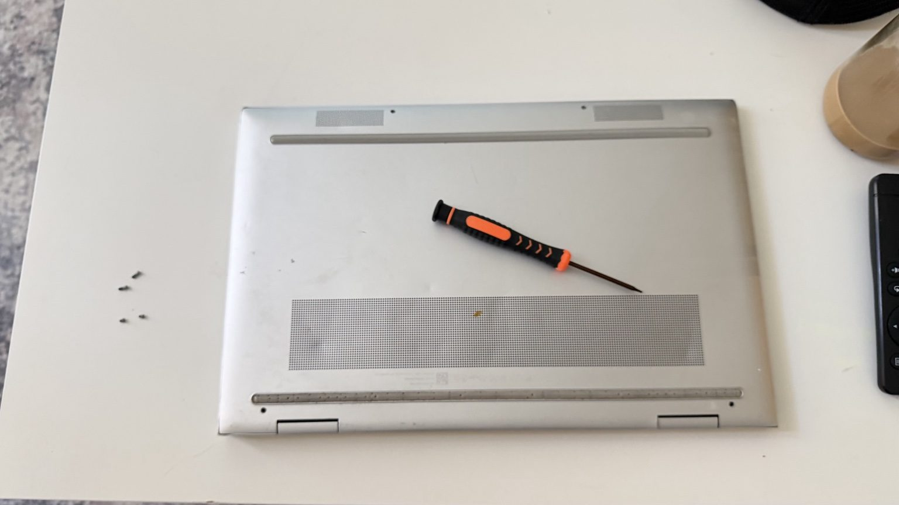
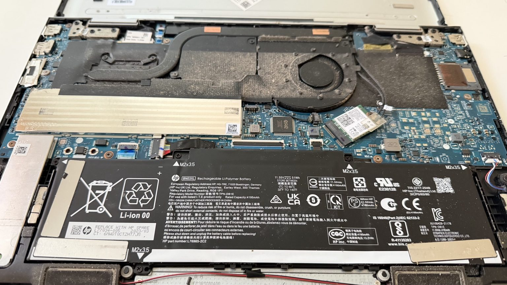
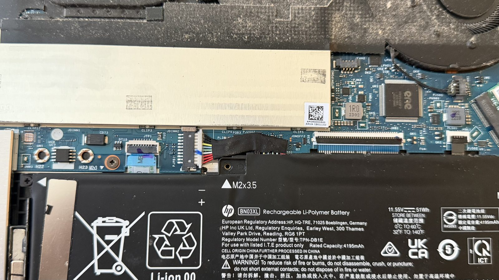
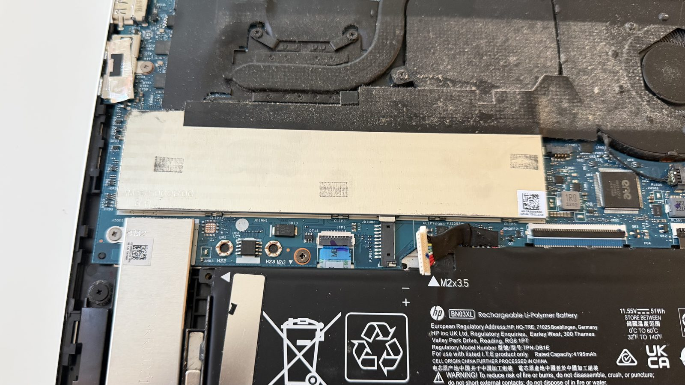
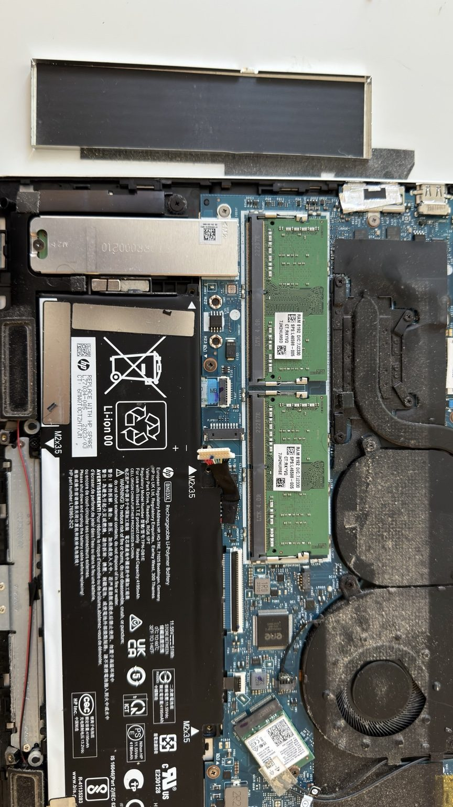
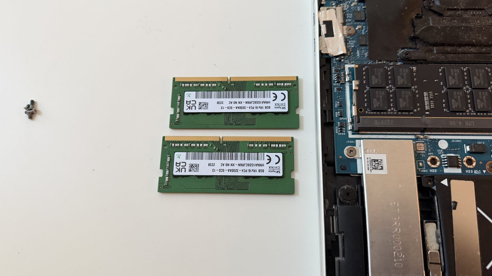
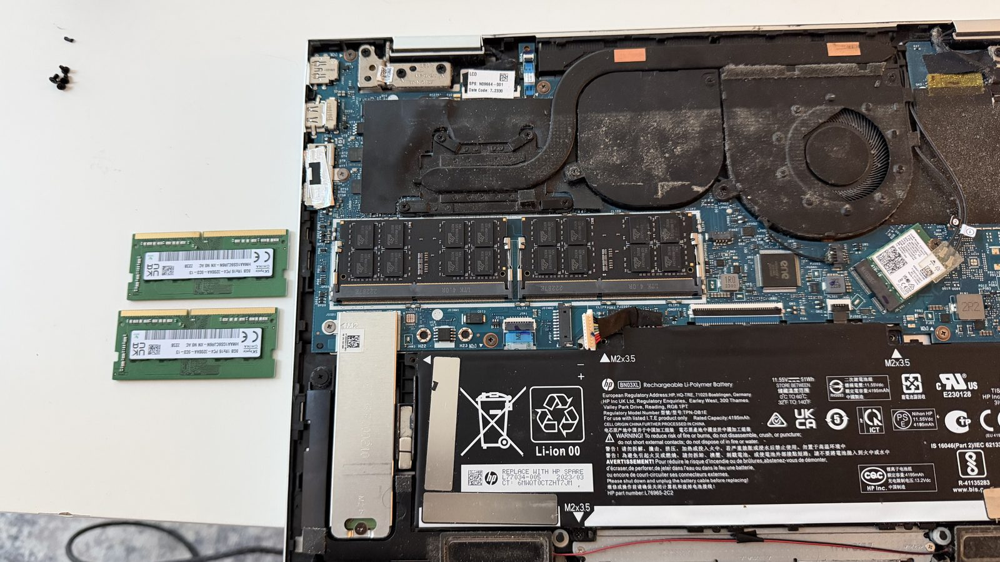
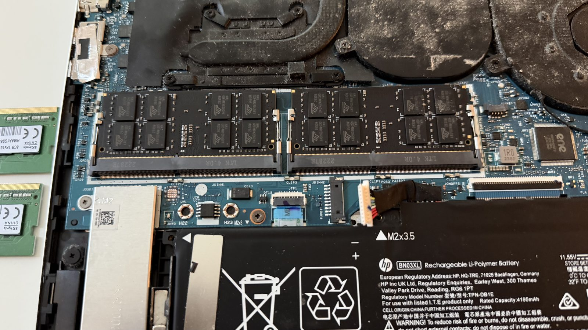
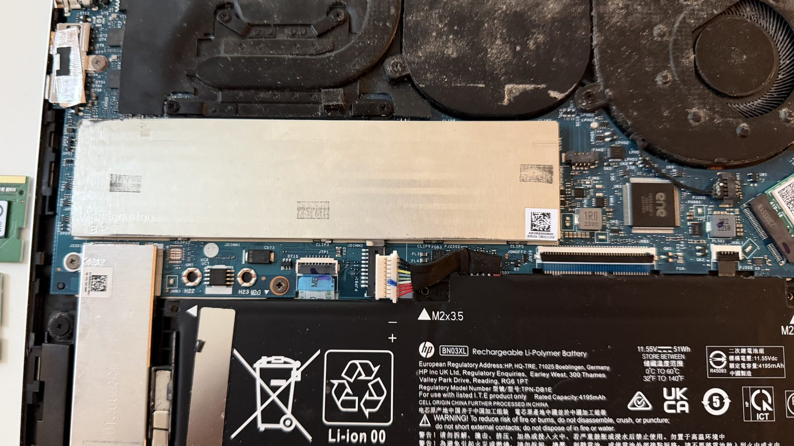
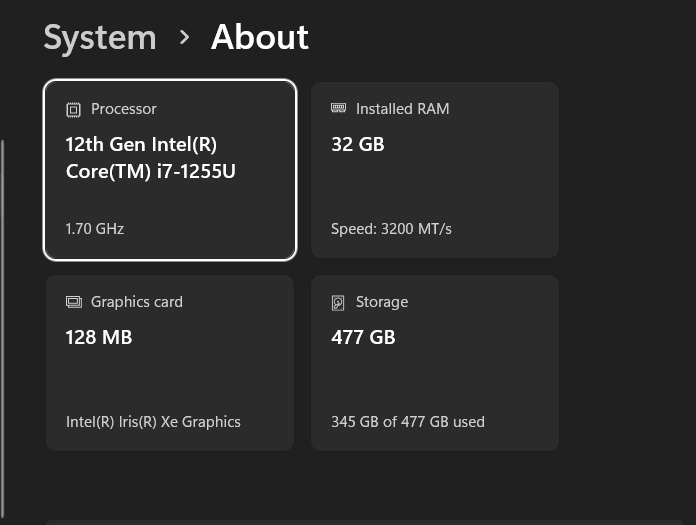

# HP ENVY x360 RAM Upgrade: 16 GB to 32 GB

**Shuaib Ahmed · November 2, 2026**  
HP ENVY x360 15-ew0023dx · Intel Core i7-1255U · Windows 11

I doubled the RAM in the laptop that runs my network labs, from 16 GB to 32 GB, so I can keep more virtual machines running at once.

| | Before | After |
| --- | --- | --- |
| Installed RAM | 16 GB (2 × 8 GB SK hynix DDR4-3200) | 32 GB |
| Speed reported by Windows | | 3200 MT/s |

## 1. Open the bottom cover

Four Torx T5 screws (two 6.2 mm, two 3.2 mm), then a plastic pry tool to release the clips. This was the hardest part of the job.

## 2. Find the RAM

The RAM sits under the long metal shield between the battery and the fan.

## 3. Disconnect the battery

Unplug the battery cable from the board before touching anything else. The battery itself stays in place.

## 4. Lift the shield

The two original modules sit underneath.

## 5. Remove the original modules

Two SK hynix 8 GB PC4-3200AA modules: the 16 GB starting point.

## 6. Install the new modules

Insert each module at an angle, press it down until the clips lock, and check that both sit flat.

## 7. Reassemble

Shield back on and battery reconnected.

## Result

Windows reports 32 GB at 3200 MT/s. Still to do: an extended memory test and a before-and-after VM benchmark.

**Reference:** [HP 15-ew0 Series Maintenance and Service Guide](https://www.manualslib.com/manual/2763873/Hp-15-Ew0-Series.html?page=41) (cover, battery, shield, and memory procedures).

---

[Return to my portfolio](https://shuaibahmedportfolio.netlify.app/)
